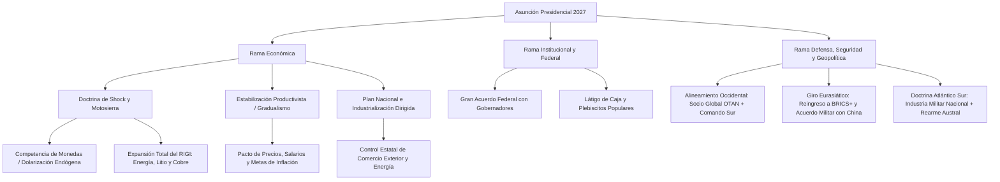
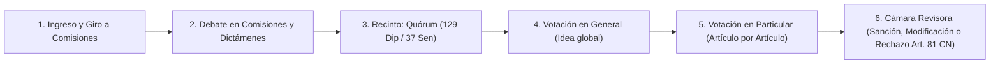
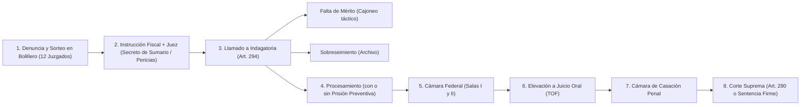

# Investigación a Fondo: Cómo armar un Simulador Político y Económico Argentino de Verdad (y no otro juego de barritas)

Mirá, te voy a ser totalmente sincero antes de que tiremos una sola línea de código en React o toquemos un componente de shadcn.. si nos ponemos a programar ahora mismo sin entender cómo funciona la máquina de picar carne que es el Estado argentino, vamos a terminar haciendo una copia maquillada de *Quién Quiere Gobernar* (QQG) y a las dos horas de jugar te vas a aburrir porque le vas a ver los hilos a la matriz. Y tonto no soy, vos tampoco, por algo me trajiste todo el desglose de lo que hace ese juego hoy y me dijiste que lo querés DEMASIADO realista, al nivel de un *Hearts of Iron IV* cruzado con la macroeconomía real de acá.

Me quedé mirando los datos que copiaste de QQG y hay cosas que me dan bronca de solo verlas (más allá de ese cartelito hermoso de `el servidor respondió 500: Error del servidor: Unexpected token... is not valid JSON` que se repite en todas las pantallas cuando intenta guardar la partida por código.. jajaja, ni un string en base64 comprimido en el cliente pudieron validar bien antes de pegarle al backend, un desastre). Pero bueno, dejando de lado el bug ese, fijate lo que hacen en la parte de Financiamiento: inventaron una moneda falopa llamada **"argentum"** donde 1 argentum son 10 millones de dólares, y te dicen que si tenés déficit menor al 5% del PBI te dan "+5 argentums fijos por mes" y que en "Política económica" tenés barritas que van de `-2` a `+2` donde poner el gasto público en Ajuste o las empresas públicas en Privatizar dice *"sin costo de presupuesto"*.

No. Eso no. Ni a palos vamos a hacer eso.

¿Cómo que cambiar la política salarial, las jubilaciones o los controles de cambios es una palanca de `-2` a `+2` sin costo directo y desconectada del resto? En Argentina tocás un botón y te explotan cuatro caños en la habitación de al lado, esa es la gracia de gobernar este país, que NADA es gratis y todo está atado con alambre. Si vos hacés un juego donde subir un impuesto o mover una palanca es una cuentita lineal aislada, perdiste toda la esencia. REALISTA lo queremos, que sientas el sudor frío cuando faltan diez días para una licitación de deuda del Tesoro, tenés las reservas netas del Banco Central en negativo por ocho mil millones de dólares, los camioneros te amenazan con un paro nacional y encima tres gobernadores del norte te piden obras de cloacas a cambio de que sus diputados bajen al recinto a darte quórum..

Así que sentate y leé esto con calma porque me puse a desarmar pieza por pieza cómo funciona Argentina en lo económico, en lo político, en el barro del Congreso, en las provincias y en lo militar, para que el motor de nuestro juego sea una bestia de simulación real.

---

## 1. El Problema de la "Caja Negra" y por qué la Economía Argentina es Única en el Mundo

Vos me dijiste que de economía y política de acá no tenés todo claro y querés que investigue qué incluir y qué sumar. Empecemos por la base: si vos agarrás un libro de texto de economía estadounidense o europeo y lo programás en el juego, el simulador no sirve para la Argentina. No sirve porque las economías normales tienen una sola moneda, tienen crédito profundo y cuando suben la tasa de interés un 0,25% anual la inflación baja seis meses después. Acá no, acá vivimos en una **economía bimonetaria, con restricción externa crónica y puja distributiva indexada**..

Lo que pasa es que.. bah, mejor dicho, lo que la mayoría de los juegos de estrategia hacen mal es que tratan al dinero del Estado como si fuera el "oro" del *Age of Empires*. Juntás oro con impuestos, gastás oro en edificios y tropas, y listo. En Argentina existen **tres cajas distintas** que se chocan todo el tiempo, y nuestro backend de simulación (que va a correr en el navegador adentro de un Web Worker en TypeScript para no tildar la pantalla, después te explico bien esa parte) tiene que separar estas tres cajas desde el minuto cero:

1. **La Caja del Tesoro Nacional (en Pesos y en Dólares):** Es la plata del Gobierno propiamente dicho (Ministerio de Economía). Recauda impuestos en pesos, paga sueldos, jubilaciones, planes, subsidios y obra pública en pesos, pero tiene que pagar deuda en pesos y en dólares. Si gasta más de lo que recauda (déficit fiscal), ¿de dónde saca la plata? No puede fabricar dólares. O pide deuda, o le pide al Banco Central que imprima pesos (Adelantos Transitorios / Giro de Utilidades).
2. **El Balance del Banco Central - BCRA (El corazón del monstruo):** En QQG ni siquiera separan bien al Tesoro del BCRA. El BCRA tiene de un lado sus **Activos** (las Reservas Internacionales) y del otro lado sus **Pasivos** (la Base Monetaria, que son los pesos en la calle, más los **Pasivos Remunerados**, que fueron las famosas Leliqs, Pases, LEFI o como les quieran poner de nombre). Escuchame bien esto porque es EL mecanismo con el que se funden los gobiernos argentinos: cuando el Tesoro emite pesos para cubrir el déficit, para que esos pesos no se vayan todos corriendo a comprar dólares y disparen la inflación al instante, el BCRA los "aspira" ofreciéndole a los bancos una tasa de interés altísima (por ejemplo, 80% o 100% anual). El problema es que esa bola de deuda del BCRA con los bancos paga intereses todos los meses.. es el famoso **déficit cuasifiscal**. Llega un momento en que aunque vos como Presidente hagas un ajuste brutal y bajes el déficit del Tesoro a cero, el BCRA tiene que imprimir billones de pesos por mes solo para pagar los intereses de los pesos que encerró el año pasado. Si no simulamos el balance del BCRA separado del Tesoro, no estamos simulando Argentina, estamos jugando al Monopoly.
3. **La Balanza de Pagos y la Restricción Externa (Los Dólares de verdad):** Acá está el verdadero límite de cualquier gobierno argentino. La gente ahorra en dólares, las fábricas argentinas necesitan importar entre un 60% y un 70% de insumos en dólares para poder fabricar un tornillo o un auto acá adentro, y la deuda externa se paga en dólares. ¿Y quién trae los dólares genuinos? El campo (soja, maíz, trigo, carne), ahora cada vez más la energía (Vaca Muerta) y la minería (litio, cobre). Esto genera el ciclo maldito argentino del **Stop and Go**: si vos reactivás la economía dando aumentos de sueldos y crédito, el PBI crece rápido, pero las importaciones industriales y de energía crecen el triple de rápido que las exportaciones.. a los diez meses te vaciaron las reservas del BCRA, te quedaste sin dólares, el mercado te hace una corrida cambiaria, tenés que devaluar de golpe, la devaluación se traslada a los precios de la comida al día siguiente, la inflación vuela, el salario real se destruye, el consumo se desploma y entrás en recesión (y recién ahí, como nadie compra nada y las fábricas paran, caen las importaciones y volvés a juntar dólares a costa de tener 50% de pobreza).

Fijate cómo cambia todo cuando entendés ese circuito. No hace falta inventar una moneda "argentum", hace falta programar esos tres balances conectados por ecuaciones reales mes a mes (o semana a semana en momentos de corrida cambiaria).

---

## 2. El Motor Macroeconómico: Qué variables reales vamos a meter y cómo se conectan

Te voy a detallar los bloques matemáticos que tiene que tener el motor económico para que no sea una caja negra y para que el jugador pueda abrir un panel de "Autopsia Económica" y ver EXACTAMENTE por qué le subió 2 puntos la inflación o por qué se le disparó el Riesgo País.

### 2.1. El Sistema Cambiario: Dólar Oficial, MEP, CCL, Blue y la Brecha
En el texto que me pasaste de QQG aparecen el Dólar Oficial y la Brecha Cambiaria, pero medio flotando en el aire. En nuestro juego el mercado cambiario tiene que operar con estas reglas:

- **Dólar Oficial Mayorista (MULC):** Si vos no ponés controles de cambios (sin Cepo), el dólar flota según la oferta de exportadores e inversores y la demanda de importadores, ahorristas y pago de deuda, más lo que vos intervengas vendiendo o comprando reservas desde el BCRA. Si ponés **Cepo Cambiario** (que en lugar de ser una barrita de -2 a +2 tiene que ser un tablero de regulaciones reales: límite de 200 USD a personas, parking de bonos, SIRA/SEDI para pisar importaciones, prohibición de girar dividendos a empresas extranjeras), vos podés clavar el Dólar Oficial o moverlo despacito al 1% o 2% mensual (*crawling peg*).
- **Dólares Paralelos (Blue, MEP y Contado con Liquidación - CCL):** Cuando vos pisás el dólar oficial con cepo pero seguís emitiendo pesos o tenés la tasa de interés por debajo de la inflación esperada, los pesos que sobran buscan salida por el MEP (bolsa local), el CCL (empresas sacando divisas afuera) y el Blue (la cueva de la calle Florida que mira la clase media y sale en las placas rojas de Crónica TV).
- **El Efecto Destructivo de la Brecha Cambiaria:** Acá es donde el juego se pone buenísimo. Si el Dólar Oficial está en $\$1.000$ y el CCL/Blue se te va a $\$1.600$ (60% de brecha), el motor del juego tiene que disparar comportamientos automáticos de los actores económicos:
  - Los productores agropecuarios dejan de vender la cosecha y meten los granos en **silobolsas** esperando que no aguantes más y devalúes. Tus exportaciones liquidadas caen un 35% aunque la cosecha haya sido buena (y ahí tenés que decidir si mandás a la AFIP/ARCA a perseguirlos, si sacás un "Dólar Soja" temporal que te destruye el balance del BCRA porque comprás dólares a $\$1.400$ y los vendés a $\$1.000$, o si devaluás de una vez).
  - Los importadores hacen lo opuesto: ven el dólar oficial regalado y te piden el doble de importaciones para acumular stock antes de que devalúes, vaciándote el BCRA. Si les pisás los permisos de importación (SIRA), a los dos meses las fábricas empiezan a parar líneas de producción por falta de insumos importados y te cae la actividad industrial y el empleo, además de generarte desabastecimiento que te recalienta los precios.

### 2.2. Reservas Brutas vs. Reservas Netas (La Verdad de la Milanesa)
En QQG te muestra "Reservas internacionales: 55,4 mil M USD". Eso en Argentina es el número para la tribuna. Nuestro juego tiene que mostrar las **Reservas Brutas** y al lado, en rojo sangre cuando corresponda, las **Reservas Netas Líquidas**.
¿Por qué? Porque dentro de las reservas brutas del BCRA están:
- Los **Encajes de los depósitos en dólares de la gente** (esos dólares son de los ahorristas que tienen caja de ahorro en el banco, no del gobierno.. si las reservas netas bajan de cero, significa que estás usando los dólares de la gente para intervenir en el mercado, y si el periodismo o los bancos se dan cuenta de que usaste demasiado los encajes, se te dispara una **Corrida de Depósitos en Dólares** estilo 2001 o agosto de 2019 donde la gente hace fila en los bancos para llevarse los billetes físicos).
- El **Swap con China** (que tiene tramos activables solo si mantenés buena relación diplomática con Beijing y no les cancelás las represas en Santa Cruz o la estación espacial en Neuquén).
- El **Oro y los DEG del FMI**.

### 2.3. La Ecuación de Inflación (Los 4 Motores)
Me tiene podrido cuando hacen juegos donde la inflación es simplemente `emisión * 0.5`. No funciona así, o sea no en el corto plazo argentino. Nuestra ecuación mensual de inflación ($\pi_t$) tiene que sumar cuatro componentes reales que vos podés ver desglosados en un gráfico de barras cada mes (Inflación Núcleo, Regulados y Estacionales):

$$\pi_t = \alpha \cdot \pi_{t-1} + \beta \cdot \Delta E_t + \gamma \cdot \Delta \text{Tarifas}_t + \delta \cdot \left(\frac{\Delta M_t - \Delta L^d_t}{M_t}\right) + \epsilon_t$$

Te lo traduzco al castellano sin vueltas para que veas lo jugable que es:
1. **Inercia ($\alpha \cdot \pi_{t-1}$):** En Argentina todo el mundo remarca precios mirando lo que pasó el mes pasado (alquileres, colegios privados, contratos, paritarias sindicales). Cuanto más alta viene siendo la inflación de los últimos 6 meses, más alto es el coeficiente $\alpha$ (la economía se indexa sola). Para romper la inercia no alcanza con dejar de emitir un mes, tenés que clavar un ancla cambiaria o hacer un plan de estabilización de shock.
2. **Pass-Through Cambiario ($\beta \cdot \Delta E_t$):** Cuando sube el dólar oficial (o el paralelo cuando hay mucho cepo), se traslada directamente al precio de los alimentos y bienes transables porque Argentina exporta lo que come (carne, trigo, maíz, aceite, leche). Y ojo: el coeficiente $\beta$ no es fijo.. si el gobierno tiene alta credibilidad y reservas, una devaluación del 10% capaz traslada solo un 3% a precios; si el gobierno es débil, no tiene reservas y nadie le cree al Ministro de Economía, devaluás un 20% y los empresarios remarcan un 25% por las dudas.
3. **Precios Regulados y Tarifazos ($\gamma \cdot \Delta \text{Tarifas}_t$):** Cuando vos querés bajar el gasto público quitando subsidios a la luz, al gas, al agua (AySA), a los colectivos del AMBA o liberando naftas y medicina prepaga, mejorás el resultado fiscal del Tesoro en el acto.. pero ese mismo mes le pegás un empujón directo al IPC de 2 o 3 puntos porcentuales y le comés el ingreso disponible a la clase media y baja.
4. **Desequilibrio Monetario y Demanda de Dinero ($\delta \cdot (\Delta M - \Delta L^d)$):** Acá no importa solo cuántos pesos emitís ($\Delta M$), sino **cuántos pesos quiere tener la gente en el bolsillo ($\Delta L^d$, la demanda de dinero)**. Si la gente confía en el peso o la actividad crece, demanda más pesos. Pero si hay pánico político, perdés las elecciones legislativas de medio término por 15 puntos o echás al presidente del BCRA a los gritos, la demanda de pesos se desploma de un día para el otro: todo el mundo quema los pesos comprando latas de atún, autos o dólares, la velocidad de circulación del dinero vuela y podés entrar en **Hiperinflación** incluso aunque ese mes no hayas emitido un solo peso nuevo.

### 2.4. Impuestos Reales, Evasión, Efecto Olivera-Tanzi y la Guerra por la Coparticipación
Lo que pusieron en QQG sobre los 17 impuestos (separando los 11 que van por Ley por el artículo 99 inciso 3 de la Constitución y los 6 que van por Decreto como retenciones y aranceles) está bien encaminado en la idea, pero se queda a mitad de camino porque le faltan las dos trampas mortales del sistema tributario argentino:

| Impuesto / Tributo | Vía Legal | ¿Se Coparticipa con Provincias? | Efecto Económico y Político Real en nuestro Simulador |
| :--- | :--- | :--- | :--- |
| **IVA (General 21% / Reducido 10,5%)** | Ley del Congreso | **SÍ** (Masa Coparticipable Bruta, salvo 11% a ANSES) | Es el que más recauda (~7% del PBI), pero es regresivo: subirlo golpea directo a los sectores populares, sube un escalón el IPC de un saque y a partir del 23-24% dispara la evasión en comercios de barrio ("¿con factura o sin factura?"). |
| **Ganancias (Sociedades y 4ta Categoría Personas)** | Ley del Congreso | **SÍ** (100% coparticipable) | Los gobernadores se mueren por que subas o restituyas Ganancias a los trabajadores porque más de la mitad de esa plata va directo a sus provincias, mientras que a vos te putean los sindicatos (Moyano, Bancarios, Petroleros) que tienen sueldos altos. |
| **Derechos de Exportación (Retenciones: Soja, Maíz, Trigo, Carne, Industria, Minería)** | Decreto (con topes legales delegados) | **NO** (100% para el Tesoro Nacional) | La droga favorita de cualquier Presidente sin mayoría en el Congreso: entra toda a tu caja sin repartir un peso con los gobernadores y además desacopla un poco el precio interno de los alimentos.. pero te pone en pie de guerra con la Mesa de Enlace y los gobernadores de la Región Centro (Córdoba, Santa Fe, Entre Ríos) y hunde la inversión del agro para la campaña siguiente. |
| **Impuesto al Cheque (Créditos y Débitos 1,2%)** | Ley del Congreso | **Casi NO** (va casi todo a Nación / ANSES) | Recaudación instantánea y imposible de evadir dentro del banco, pero arriba del 1,2% empuja a toda la economía a manejarse en efectivo en negro, agrandando la informalidad laboral y comercial. |
| **Aportes (17%) y Contribuciones Patronales (20,4%)** | Ley del Congreso | **NO** (Va a ANSES y Obras Sociales Sindicales) | Acá está el nido de avispas: si bajás contribuciones patronales fomentás el blanqueo laboral de ese 40% de trabajadores en negro, pero desfinanciás ANSES en el corto plazo (que ya es deficitaria). Y si tocás el porcentaje que va a las **Obras Sociales Sindicales**, la CGT te decreta un paro general por tiempo indeterminado a las 24 horas. |
| **Impuesto PAIS / Recargos al Dólar / Aranceles** | Decreto / Ley | **NO** (o reparto mínimo en obras) | Recauda una barbaridad mientras tenés cepo cambiario (~1,5% del PBI), pero encarece los insumos importados de la industria y, cuando quieras salir del cepo y unificar el dólar, perdés esa recaudación de golpe. |
| **Bienes Personales / Impuesto a las Grandes Fortunas** | Ley del Congreso | **Parcial / Asignación específica** | Te da puntos de aprobación en votantes de izquierda y centroizquierda, pero si te pasás de rosca con la alícuota los empresarios de alto patrimonio cambian la residencia fiscal a Uruguay (literalmente tenemos que tener el indicador de *Fuga de Contribuyentes a Montevideo / Punta del Este* ja) y cae la inversión local. |

¿Ves esa columna del medio que dice **¿Se Coparticipa con Provincias?**? En QQG no le dan bola a eso, y en la política argentina real el 80% de las peleas entre el Presidente y los Gobernadores pasa por ahí. Según la **Ley 23.548 de Coparticipación Federal**, de los impuestos coparticipables (IVA, Ganancias, Internos), aproximadamente el 42% queda en Nación, casi el 57% se reparte automáticamente todos los días por goteo del Banco Nación a las 24 jurisdicciones según coeficientes fijos, y el 1% va al fondo de **ATN (Aportes del Tesoro Nacional)** que maneja el Ministro del Interior con la billetera abierta para apagar incendios o comprar voluntades políticas.

Entonces mirá qué jugabilidad hermosa se arma sola sin inventar reglas artificiales:
- Si sos **Presidente** y necesitás cerrar el déficit fiscal sin compartir un mango con las provincias, subís retenciones, impuesto a los combustibles o impuesto PAIS por decreto, y pisás las transferencias discrecionales.. los gobernadores ven que vos tenés superávit mientras a ellos se les cae la recaudación del IVA y Ganancias por la recesión, y te mandan a sus diputados y senadores a voltearte los DNU o votarte leyes de gasto forzado (como aumentos a jubilados o universidades) para romperte el superávit.
- Si sos **Presidente** y necesitás que te voten una Reforma Laboral o la Ley Bases, les ofrecés a los gobernadores el "paquete fiscal": restituir el Impuesto a las Ganancias a los sueldos medios-altos. Vos te comés el costo político con la clase media y la CGT, pero los gobernadores reciben miles de millones extra por coparticipación automática y te levantan la mano en el recinto.

---

## 3. Los 4 Roles Jugables: Presidente, Gobernador, Diputado y Senador

Vos me pediste algo clave que QQG no tiene bien resuelto (y de hecho en QQG ni siquiera podés jugar como legislador): **que te puedas postular directamente a Presidente, Gobernador, Diputado o Senador**, y que dependiendo del rol que elijas, el juego tenga pantallas, mecánicas, problemas y botones completamente distintos. Al estilo *Hearts of Iron IV* mezclado con un RPG político pesado.

Vamos a diseñar cada uno de los cuatro roles para que ninguno se sienta como un "modo recortado", sino como cuatro experiencias de poder distintas dentro del mismo mundo vivo.

### 3.1. Rol 1: Presidente de la Nación (El Sillón de Rivadavia)
Es el modo macro total. Gobernás desde Casa Rosada y Olivos.
- **El Gabinete Real (No solo números de desempeño):** En QQG vimos que tenés a los ministros con `Competencia`, `Lealtad` y `Riesgo`, y un botón que dice `Reforzar (Costo: -20,5)`. Está bien la base de atributos, pero en nuestro juego cada ministro es un **Personaje Persistente (NPC)** con:
  - **Facción / Partido de origen:** Si armaste una coalición para ganar el balotaje, tus aliados te van a exigir ministerios con caja (Obras Públicas, Desarrollo Social/Capital Humano, Interior, Transporte o ANSES/PAMI). Si no les das los cargos que prometiste en el acuerdo de Acassuso o donde sea, sus diputados te dejan de votar las leyes al segundo mes.
  - **Ideología y Ortodoxia:** Si ponés a un Ministro de Economía ortodoxo/monetarista del establishment financiero, el Riesgo País te baja 150 puntos de entrada y el FMI te sonríe, pero si vos por atrás le obligás a congelar tarifas o emitir para las elecciones, el ministro pierde credibilidad, se pelea con vos en off the record con los periodistas de Clarín o La Nación y si te renuncia en medio de una corrida cambiaria te clava un +25% al dólar paralelo en una tarde.
  - **Desgaste ("Fusibles") y Carpetazos:** Los ministros en Argentina son fusibles del Presidente. Cuando explota un escándalo de corrupción (sobreprecios en alimentos, bolsos, vacunas VIP, criptomonedas, seguros, coimas en la aduana) o una crisis de seguridad, el ministro absorbe el golpe de imagen. Si lo echás a tiempo, salvás tu aprobación personal pero te ganás un enemigo político que puede salir a hablar en televisión; si lo sostenés por capricho o porque es tu mano derecha, el desgaste te empieza a comer la imagen positiva a vos mes a mes.
- **Las Herramientas Ejecutivas:**
  - **Decretos de Necesidad y Urgencia (DNU - Art. 99 inc. 3 CN):** Podés desregular media economía de un plumazo en el primer día de gobierno (prohibido para impuestos, penal, electoral y partidos políticos). El DNU entra en vigencia YA, pero va a la **Comisión Bicameral de Trámite Legislativo**. Y acá aplica la **Ley 26.122 real**: mientras una sola de las dos cámaras (Diputados o Senado) NO lo rechace, tu DNU sigue vivo. Si la oposición logra juntar mayoría simple en Diputados Y en el Senado para volteártelo, el DNU queda derogado y tu autoridad presidencial se desploma.
  - **Veto Total o Parcial (Art. 80 y 83 CN):** Si el Congreso te aprueba una ley que te rompe el déficit fiscal, vos la vetás total o parcialmente. Pero ojo: la ley vuelve al Congreso, y si la oposición junta **dos tercios (2/3)** de los presentes en ambas cámaras, te levantan el veto y estás obligado a promulgarla. Entonces aparece la mecánica de **"Los 87 Héroes"**: tenés que usar al Ministro del Interior, la SIDE y la chequera de obras/ATN para convencer al menos a un tercio más uno de los diputados para que se ausenten, se abstengan o den vuelta su voto y te blinden el veto.
  - **Intervención Federal (Art. 6 y 75 inc. 31 CN):** Si una provincia entra en caos total, sedición, rebelión policial o emite una cuasimoneda ilegal y desconoce a la Corte Suprema, podés intervenir el Poder Ejecutivo o Judicial de esa provincia (por Congreso, o por decreto en receso parlamentario sujeto a ratificación), sacando al Gobernador del medio y poniendo un Interventor Federal tuyo.. a cambio de un incendio político federal descomunal.

### 3.2. Rol 2: Gobernador Provincial / Jefe de Gobierno de CABA (Las 24 Jurisdicciones)
En QQG las provincias son casi una planilla con tres numeritos distintos. Eso en nuestro juego NO VA A PASAR. Gobernar la Provincia de Buenos Aires no tiene NADA que ver con gobernar CABA, ni Neuquén, ni Formosa.
Cuando elegís ser Gobernador, tu tablero cambia por completo:
- **No tenés Banco Central (Salvo la opción nuclear: emitir Cuasimonedas):** Como gobernador vos no podés imprimir pesos. Si te quedás sin plata para pagar el aguinaldo de diciembre de los policías y los maestros, tenés tres opciones: pedirle un rescate de ATN al Presidente (que te va a pedir a cambio que tus diputados nacionales voten su ley de ajuste), endeudarte en dólares o con el banco provincial (Banco Provincia, Bancor, etc.), o mandar a tu Legislatura Provincial la creación de un **Bono de Cancelación de Deuda (Cuasimoneda: Patacones, Lecop, Bocade / "Chachos")**. La cuasimoneda te salva de la quiebra inmediata pero cotiza al 70% u 80% de su valor nominal en los supermercados, te genera inflación local y Nación te puede prohibir que los bancos la acepten.
- **Impuestos Provinciales Reales:** Vos no manejás el IVA ni las Retenciones. Tu recaudación propia viene de:
  - **Ingresos Brutos (IIBB):** El impuesto más distorsivo y en cascada de la economía argentina, pero que representa el 75% de la recaudación propia de cualquier provincia. Si lo subís te llenás de caja rápido, pero encarecés todos los precios en tu provincia y las empresas se mudan a la provincia vecina si el gobernador de al lado les ofrece exención de IIBB.
  - **Impuesto Inmobiliario Rural y Urbano:** Si sos gobernador de Buenos Aires, Córdoba o Santa Fe y subís el Inmobiliario Rural por encima de la inflación, los productores rurales de tu provincia te hacen una rebelión fiscal (dejan de pagar las boletas) y te cortan las rutas con tractores.
  - **Impuesto a los Sellos y Patentes Automotores.**
  - **Regalías Hidrocarburíferas y Mineras (Art. 124 CN):** En Argentina los recursos naturales son de las provincias. Si gobernás Neuquén, Chubut, Santa Cruz o Mendoza, cobrás el 12% (o más en nuevas concesiones) de regalías sobre cada barril de petróleo y metro cúbico de gas que sale de tu suelo; si gobernás Jujuy, Salta, Catamarca o San Juan, negociás directo con las mineras extranjeras por el litio, el oro y el cobre (y lidiás con los cortes de ruta de comunidades locales y ambientalistas por el uso del agua).
- **Asimetría Real entre las 24 Provincias:**
  - **Provincia de Buenos Aires (La Madre de Todas las Batallas):** Concentra el 38% de la población del país, aporta casi el 35% del PBI pero recibe apenas el ~22% de la coparticipación federal (está estructuralmente desfinanciada desde 1988). Tenés el Conurbano bonaerense dividido en Primera y Tercera Sección Electoral, con **Intendentes ("Los Barones del Conurbano")** que manejan el territorio, los punteros y la fiscalización: si te peleás con los intendentes de La Matanza, Lomas de Zamora o Quilmes, en las elecciones te reparten la boleta cortada y perdés aunque midas bien en la tele. Además manejás a la **Policía Bonaerense** (90.000 efectivos, con riesgo constante de corrupción, zonas liberadas o acuartelamiento policial rodeándote la Gobernación en La Plata o la Quinta de Olivos si el sueldo les queda atrás de la Policía de la Ciudad).
  - **CABA:** Presupuesto riquísimo por habitante, sin problemas de infraestructura básica, pero sos la vidriera nacional: cada piquete en la 9 de Julio o acampe frente a Desarrollo Social te corta el tránsito a vos y tus votantes te exigen que levantes los cortes y saques a los manteros.
  - **Córdoba, Santa Fe, Mendoza (El Eje Productivo):** Fuerte peso del campo, la industria metalmecánica/alimenticia y los servicios; votantes con fuerte identidad local que desconfían del centralismo porteño; en Rosario (Santa Fe) tenés la crisis crítica de **Narcotráfico y Sicariato** donde necesitás coordinar con Nación el envío de Gendarmería y Prefectura o reformar tu sistema penitenciario provincial con pabellones de alto perfil estilo Bukele.
  - **Provincias del Norte con alto Empleo Público (Formosa, La Rioja, Catamarca, Santiago del Estero, Chaco):** Más del 60% del empleo formal depende del Estado provincial o municipal y más del 85% de tu presupuesto viene de la Coparticipación Nacional. Si tenés reelección indefinida (o reformás la Constitución provincial para tenerla) y controlás la justicia local y el reparto de bolsones y cargos, sos prácticamente invencible en las urnas locales.. salvo que el Presidente de la Nación te cierre por completo el grifo de fondos discrecionales y te asfixie financieramente hasta que la calle te estalle.
- **Tu Arma Geopolítica Interna como Gobernador:** Vos sos el jefe político de los Diputados y Senadores Nacionales que responden a tu partido provincial. Cuando el Presidente necesita aprobar el Presupuesto o una reforma en el Congreso Nacional, el teléfono que suena es el tuyo. Podés armar **"Ligas de Gobernadores"** (Patagónicos, Norte Grande, Región Centro) para plantarte en bloque frente a Casa Rosada e imponerle condiciones.

### 3.3. Rol 3: Diputado Nacional (257 Bancas - La Rosca, el Quórum y el Trampolín)
Acá me quiero detener porque casi ningún juego en el mundo sabe hacer divertido jugar como legislador, y en Argentina ser Diputado Nacional puede ser un JUEGAZO si lo enfocamos desde la construcción de poder real.
Cuando arrancás como Diputado Nacional (podés entrar como un diputado raso "outsider" que se hizo viral en redes/tele, un cuadro sindical, un alfil de un gobernador o el Presidente de un Bloque):
- **Tu Moneda de Juego no es el Presupuesto del Tesoro, es el Capital Político, la Influencia en Comisiones, el Aparato Partidario y los Minutos de Aire:**
- **El Ciclo de Trabajo Legislativo Real:**
  1. **Las Comisiones Permanentes:** Las leyes no nacen en el recinto, nacen o mueren cajoneadas en las comisiones (Presupuesto y Hacienda, Asuntos Constitucionales, Legislación General, Juicio Político, Trabajo). Tu primer objetivo de carrera como diputado es negociar con las autoridades de la Cámara para meterte en una comisión clave, o llegar a presidirla. Si sos el **Presidente de la Comisión de Presupuesto y Hacienda**, vos decidís qué proyectos se tratan el martes a la tarde y cuáles duermen en un cajón durante dos años (salvo que el recinto te vote un emplazamiento a comisión con mayoría especial).
  2. **Dictámenes de Mayoría y de Minoría:** Antes de ir a votar al recinto, en la comisión se negocia artículo por artículo. Vos podés firmar el dictamen del oficialismo, firmar en disidencia parcial (para cobrar tu voto después en el recinto en la votación en particular artículo por artículo.. ¡acordate de cómo se cayó la primera Ley Bases en febrero de 2024 cuando pasaron a votar los incisos en particular!), o armar un dictamen de minoría propio con otros bloques.
  3. **La Guerra del Quórum (Los 129 sentados):** En Argentina la oposición o el oficialismo ganan o pierden batallas antes de empezar la sesión. Si faltan 3 minutos para que se cumpla la media hora reglamentaria y hay 127 diputados sentados en sus bancas, vos y tu bloque de 4 diputados "dialoguistas" están parados en el pasillo tomando café.. y en ese instante te llama el Ministro del Interior o el Presidente de la Cámara por teléfono ofreciéndote cargos en ANSES de tu provincia, el giro de una obra vial o incorporar un artículo que beneficia a una industria de tu distrito si te sentás y das el número 129. ¡Imaginate jugar ese minijuego en tiempo real con el reloj corriendo de 30 minutos a 0!
  4. **Interpelaciones, Pedidos de Informes y Mociones de Privilegio:** Aunque seas oposición en minoría, podés usar tus 5 minutos de moción de privilegio o las sesiones informativas del Jefe de Gabinete (Art. 101 CN) para tirarle un carpetazo en la cara a un ministro, viralizar el recorte en redes sociales y televisión, subir 4 puntos tu conocimiento nacional e instalar tu candidatura a Gobernador o Presidente para la próxima elección.
  5. **Ruptura de Bloques y "Borocotización":** Podés traicionar a tu jefe político, romper el bloque con otros 5 diputados heridos en el cierre de listas, armar tu propio monobloque o interbloque "Federal" y vender tus votos al mejor postor en un Congreso partido en tercios.

### 3.4. Rol 4: Senador Nacional (72 Bancas - El Club de los Feudos y el Juicio Político)
El Senado es otro animal completamente distinto a Diputados. Son solo 72 bancas (3 por cada provincia y 3 por CABA: 2 para el que sale primero y 1 para el que sale segundo), se renueva por tercios cada 2 años (8 provincias por turno) y los mandatos duran **6 años**.
¿Por qué jugar de Senador es fascinante y re distinto a ser Diputado?
- **El Poder de Fuego Individual:** En Diputados tu voto es $1/257$ ($0,38\%$). En el Senado tu voto es $1/72$ ($1,38\%$), y para tener quórum se necesitan 37 senadores. Dos o tres senadores provinciales sueltos definen el destino de un gobierno entero.
- **Facultades Exclusivas del Senado (Lo que Diputados NO puede hacer):**
  - **La Comisión de Acuerdos (Jueces, Embajadores, Militares y BCRA):** El Presidente no puede nombrar a un juez de la Corte Suprema (necesita **2/3 de los presentes** en el Senado), ni al Procurador General (el jefe de todos los fiscales), ni a los jueces federales de Comodoro Py, ni a los embajadores políticos, ni ascender a un Coronel a General, ni confirmar al directorio del Banco Central sin que pase por la audiencia pública y el voto del Senado. Si sos Senador y estás en la Comisión de Acuerdos, tenés a la Casa Rosada agarrada del cuello: *"¿Querés que te votemos el pliego de tu juez para la Corte Suprema? Bueno, nombrame a estos tres jueces federales en mi provincia y mandame el fondo compensador del transporte"*.
  - **Cámara de Origen de la Coparticipación (Art. 75 inc. 2 CN):** Cualquier reforma al reparto de plata entre Nación y Provincias tiene que empezar obligatoriamente en el Senado.
  - **El Juicio Político (Art. 53 y 59 CN):** Si la Cámara de Diputados acusa al Presidente, al Vicepresidente, al Jefe de Gabinete, a un Ministro o a un miembro de la Corte Suprema, **el Senado se constituye en Tribunal bajo juramento**. Si sos Senador, vos juzgás y votás la destitución (con mayoría de 2/3 de los presentes) e incluso podés declararlo incapaz de ocupar cualquier empleo de honor o a sueldo de la Nación de por vida.

---

## 4. El Poder Real detrás del Escenario: Los Actores que no votan en el Congreso pero te voltean un Gobierno

Si vos hacés un simulador donde solo existen el Congreso y los indicadores macroeconómicos, te falta la mitad de la película argentina. Acá hay corporaciones y grupos de poder que tienen capacidad de veto real en la calle o en los mercados. En nuestro juego vamos a modelar un **Sistema de Grupos de Presión y Corporaciones**, cada uno con su barra de **Relación con el Gobierno (0 a 100)**, su **Poder de Fuego / Capacidad de Daño (0 a 100)** y su **Caja Económica**:

1. **La CGT y los Sindicatos Sectoriales:**
   No es un bloque monolítico. Adentro tenés al sector **Dialoguista ("Los Gordos" e Independientes: Comercio, Sanidad, UOCRA, UPCN)**, al sector **Combativo / Moyanista (Camioneros, Bancarios, Mecánicos SMATA, Aeronáuticos)** y a los **Gremios Estatales y Docentes (ATE, CTERA)**.
   - *¿Qué quieren?* Paritarias que le ganen o empaten a la inflación, que no les toques la Ley de Asociaciones Sindicales (reelección indefinida de secretarios generales y personería gremial única), que no elimines las cuotas solidarias compulsivas y, por sobre todas las cosas, que no desregules ni les saques el manejo de la caja de las **Obras Sociales** y el Fondo Solidario de Redistribución.
   - *¿Qué te hacen si les declarás la guerra?* Primero paros sectoriales (por ejemplo, paro de transporte de UTA/Trenes o paro de aeronáuticos en Aerolíneas Argentinas que te revienta el turismo en vacaciones, o paro de Camioneros que te desabastece los supermercados y estaciones de servicio en 72 horas), después **Paro General Nacional de 24 o 36 horas con movilización a Plaza de Mayo**, que te resta actividad económica ese mes y le da señal de debilidad al mercado si la adhesión es alta.
   - *¿Cómo les podés doblar el brazo?* Podés dividirlos (darle fondos de obras sociales a los Gordos para que le vacíen el paro a los combativos), descontar el día de paro a los estatales, declarar servicio esencial al transporte y la educación para obligar a guardias mínimas del 75%, o usar a la Justicia para intervenir un sindicato con causas de corrupción.. pero si lo hacés cuando la inflación está volando y el salario real cae 15%, la base de los trabajadores te pasa por encima a los propios dirigentes sindicales.

2. **Los Movimientos Sociales y Piqueteros:**
   Manejan los comedores comunitarios, las cooperativas de trabajo y la movilización callejera en el AMBA y las grandes ciudades.
   - *La mecánica clave:* **Intermediación vs. Transferencia Directa**. Si les dejás el control de las altas y bajas de los planes sociales y el reparto de alimentos secos, te garantizan "paz social" en el Conurbano (sobre todo en el mes maldito: **Diciembre**). Pero te cuestan una fortuna en presupuesto y te hunden la aprobación en tus votantes de clase media que ven los cortes de calle todos los días por la tele. Si les cortás la intermediación, auditás los planes y aplicás el **Protocolo Antipiquetes** con fuerzas federales, subís fuerte en imagen de autoridad y orden, pero el índice de **Tensión Social en Barrios Vulnerables** queda atado directamente al precio de los alimentos (Canasta Básica Alimentaria / Indigencia). Si la indigencia pasa del 12-15% en diciembre y no tenés red territorial ni contención de los intendentes y movimientos, se activa el riesgo de **Saqueos y Estallido Social**.

3. **El Círculo Rojo (La UIA, la Mesa de Enlace, los Bancos de ADEBA/ABA y las Energéticas):**
   Tienen intereses opuestos entre sí y vos tenés que hacer equilibrio en una cuerda floja:
   - **La UIA (Unión Industrial Argentina) y las PyMEs industriales:** Quieren dólar alto para que no entren productos importados baratos, aranceles altos a Brasil y China, tarifas de luz y gas subsidiadas y crédito blando a tasa negativa. Si abrís las importaciones de golpe con el dólar atrasado, te bajan los precios de la ropa y los electrodomésticos (la clase media festeja que puede comprar zapatillas y celulares baratos), pero a los 8 meses empiezan a cerrar fábricas textiles, metalúrgicas y de calzado en el Conurbano y Santa Fe, subiendo el desempleo a dos dígitos.
   - **La Mesa de Enlace y los Agroexportadores (SRA, CRA, Coninagro, FAA + CIARA-CEC):** Quieren dólar único sin brecha, retenciones cero y que no intervengas las exportaciones de carne ni trigo. Tienen la llave de los dólares del BCRA.
   - **Los Bancos y Fondos de Inversión (Locales y Wall Street):** Son los que te compran las letras y bonos del Tesoro en cada licitación quincenal (*Roll-over* de la deuda en pesos). En nuestro juego, **dos veces por mes hay Licitación del Tesoro**: si ese mes te vencen 10 billones de pesos y los bancos ven que tu plan fiscal hace agua o que la oposición te está por voltear al Ministro de Economía, te renuevan solo el 60% (*roll-over* del 60%) o te piden tasas de interés usurarias. ¿Qué pasa con ese 40% de pesos que los bancos no te renovaron? Quedan sueltos en la calle y van directo a comprar Dólar MEP y CCL al día siguiente, armándote una corrida cambiaria en vivo.

4. **El Cuarto Poder (Grupos Mediáticos, Canales de Noticias y Redes Sociales):**
   En QQG esto ni existe y es fundamental. En Argentina hay medios hegemónicos, canales de cable de noticias 24 horas que operan para distintos bandos y ahora un ecosistema brutal de streaming y redes sociales (X/Twitter, TikTok, YouTube).
   - **La Pauta Oficial y la Regulación de Medios / Telecomunicaciones:** Cuando asumís como Presidente o Gobernador, decidís qué hacés con la **Pauta Publicitaria Oficial**. Si ponés Pauta Cero, ahorrás presupuesto y ganás relato anticasta, pero los grupos mediáticos tradicionales pierden ingresos y te suben la sensibilidad ante cualquier error de gestión (un escándalo de nivel 3 te lo convierten en tapa de diario durante dos semanas). Si repartís pauta discrecionalmente o les das negocios de telecomunicaciones/fibra óptica/espectro 5G, conseguís **Blindaje Mediático** (las malas noticias económicas pegan un 30% menos en la opinión pública durante unos meses), pero si se filtra cuánto le pagás a cada periodista ensobrado te comés un golpe de credibilidad.

5. **Comodoro Py, la Corte Suprema y la SIDE (Servicios de Inteligencia):**
   Mirá cómo funciona la justicia federal en Argentina, porque no hay que ser ingenuo: los jueces federales de Comodoro Py tienen un sensor biológico que mide la **Aprobación Presidencial y la Intención de Voto**.
   - Mientras tengas más del 50% de imagen positiva y chances de reelegir, las causas de corrupción contra tu gobierno caminan a paso de tortuga.
   - En cuanto tu aprobación cae abajo del 30% o perdés las elecciones de medio término, los expedientes que estaban dormidos hace tres años se reactivan solos, llaman a indagatoria a tus secretarios y ministros, y la Corte Suprema te empieza a sacar fallos en contra declarando inconstitucionales tus decretos o tus reformas.
   - Para contrarrestar esto (o para atacar a tus rivales), como Presidente tenés el control de la **SIDE (Secretaría de Inteligencia de Estado)** y los **Fondos Reservados**: podés destinarlos a inteligencia estratégica real (antiterrorismo, fronteras, ciberdefensa) o desviarnos a "operaciones políticas internas" (juntar carpetas sobre jueces, sindicalistas, gobernadores y opositores para extorsionarlos en las votaciones del Congreso). Si una operación interna sale mal y se filtra a la prensa o la Comisión Bicameral de Inteligencia te descubre, te estalla un escándalo institucional de magnitud máxima que puede habilitar un pedido de Juicio Político.

---

## 5. El Módulo Militar, Geopolítico y de Seguridad (Al Estilo Hearts of Iron IV)

Me pediste específicamente que el sistema militar funcione de forma realista y profunda al estilo **HOI4**, y además que exista un sistema de árboles de decisiones estratégicas. Esto le da al juego una dimensión que ningún otro simulador político web tiene hoy.

### 5.1. Los Árboles de Enfoques Nacionales y Provinciales (*National Focus Trees*)
Igual que en el *Hearts of Iron IV*, en vez de tener solamente botoncitos sueltos de medidas, el jugador (tanto si es Presidente como Gobernador, e incluso las agendas parlamentarias de los bloques en el Congreso) va a tener un **Árbol de Enfoques (Focus Tree)** gigantesco, dividido en ramas con caminos mutuamente excluyentes que tardan entre 14, 30, 60 o 90 días en completarse y van transformando la estructura del país:



Cada nodo del árbol pide requisitos reales (por ejemplo: *"Requiere: Ley de Reforma del Estado aprobada en el Congreso O Decreto 70 vigente; Reservas Netas > +5.000 M USD; Relación con EE.UU. > 70"*) y al completarse desbloquea mecánicas nuevas, modifica ecuaciones estructurales de la economía o dispara eventos geopolíticos.

### 5.2. Las Fuerzas Armadas y el Mapa Militar Táctico
En nuestro juego, la pestaña de **Defensa y Mapa Militar** no va a ser un dibujito decorativo. Vamos a modelar el **Estado Mayor Conjunto (EMCO)** y las tres fuerzas reales con sus brigadas, bases, equipamiento, logística y nivel de alistamiento:

- **Ejército Argentino:** Dividido en sus divisiones reales (1ra División de Ejército en el Noreste/Curuzú Cuatiá, 2da División "Ejército del Norte" en Córdoba/Mendoza/Salta, 3ra División en Bahía Blanca/Patagonia y la Fuerza de Despliegue Rápido). Controlás el parque de blindados (**TAM 2C-A2** modernizados con tecnología israelí Elbit, la compra de blindados a rueda **8x8 Stryker o Guarani o VN-1**), artillería, helicópteros de asalto y tropas de montaña y monte.
- **Fuerza Aérea Argentina (FAA):** Bases aéreas (Tandil, Reynolds en San Luis, Río Gallegos, El Palomar, Reconquista). Tenés la incorporación y mantenimiento de los **cazas supersónicos F-16 Fighting Falcon** (con su armamento AIM-9X / AIM-120 AMRAAM que depende de que Washington no te bloquee los repuestos ni los códigos), o la alternativa de romper con occidente e ir por cazas chinos **JF-17 Thunder / J-10C** o franceses **Rafale**, más los aviones de entrenamiento/ataque ligero **IA-63 Pampa III** fabricados en **FAdeA (Córdoba)** y los aviones de transporte Hércules C-130 y Boeing 737.
- **Armada Argentina (ARA):** Base Naval Puerto Belgrano, Base Naval Mar del Plata y la **Base Naval Integrada en Ushuaia**. El gran dolor de cabeza de la Armada en 2027 es la **Fuerza de Submarinos** (recuperar la capacidad submarina comprando clase Scorpène a Francia o Tipo 209/214 a Alemania), modernizar las fragatas/destructores MEKO 360 y corbetas MEKO 140, los patrulleros oceánicos OPV (Bouchard, Piedrabuena, Storni, Cordero) y los aviones de patrulla marítima **P-3C/N Orion** para vigilar el Atlántico Sur.
- **Complejo Industrial-Militar y Científico Nacional:**
  - **FONDEF (Fondo Nacional de la Defensa):** Porcentaje de los ingresos corrientes del Presupuesto Nacional dedicado exclusivamente a reequipar las FF.AA. Si en tu ajuste fiscal le metés un recorte o subejecutás el FONDEF, el alistamiento cae en picada.
  - **INVAP (Bariloche), Fabricaciones Militares, Tandanor y FAdeA:** Podés invertir en radares 3D nacionales (RPA), satélites militares de observación (ARSAT / SAOCOM), drones artillados nacionales, reactores nucleares (CAREM y el proyecto histórico de un **submarino de propulsión nuclear argentino**) o privatizar/cerrar empresas deficitarias ahorrando gasto pero perdiendo autonomía tecnológica militar.

### 5.3. Teatros de Operaciones, Seguridad Interior e Hipótesis de Conflicto
¿Para qué sirven las Fuerzas Armadas y las Fuerzas Federales (Gendarmería, Prefectura, PSA, Policía Federal) dentro del gameplay mes a mes?

1. **Teatro Norte (Operativo Fronteras / Escudo Norte):** Despliegue de radares de INVAP, cazas interceptores (con debate de **Ley de Derribo** en el Congreso) y batallones de Gendarmería/Ejército en las fronteras con Bolivia, Paraguay y Brasil para frenar el ingreso de vuelos narco y contrabando. Si descuidás el Norte, el índice de **Penetración del Narcotráfico** sube en Rosario, Córdoba y el Conurbano bonaerense.
2. **Teatro Urbano de Seguridad Interior (Rosario y AMBA):** Reforma de la **Ley de Seguridad Interior y Ley de Defensa Nacional**. Por defecto en Argentina las FF.AA. tienen prohibido intervenir en seguridad interior (solo apoyo logístico en zonas de emergencia como en Rosario). Si mandás una ley al Congreso para que el Ejército pueda patrullar y combatir directamente al narcoterrorismo o reprimir disturbios graves, ganás poder de fuego contra las bandas criminales y piquetes duros, pero te enfrentás a planteos de inconstitucionalidad en la Corte, rechazo de organismos de Derechos Humanos y resistencia dentro de los propios generales del Ejército que no quieren terminar presos en diez años como pasó en la historia argentina.
3. **Teatro Atlántico Sur, Milla 200, Malvinas y Antártida:**
   - **Control de la Zona Económica Exclusiva (Milla 200):** Todos los veranos cientos de buques pesqueros extranjeros (chinos, españoles, coreanos) se ponen en la Milla 201 y se meten de noche a depredar el calamar argentino. Si tenés a la Armada y Prefectura con presupuesto de combustible, los P-3 Orion volando y las OPV patrullando, capturás buques ilegales, cobrás multas millonarias en dólares, protegés las exportaciones pesqueras y te sube la aprobación patriótica; si hundís un buque chino en un incidente confuso, tenés una crisis diplomática con Beijing que te puede congelar el Swap del BCRA al día siguiente.
   - **Cuestión Malvinas y Proyección Antártica:** Desde la vía diplomática en la ONU y el bloqueo económico/logístico a las empresas petroleras y pesqueras que operan con licencias ilegales británicas en las islas, hasta el escenario de alta tensión militar en el Atlántico Sur si el Reino Unido amplía su zona de exclusión o explota petróleo en la cuenca norte de Malvinas, pasando por la disputa por la puerta de entrada a la Antártida desde Ushuaia y Petrel.
   - **Crisis Internas y Levantamientos:** Si el salario de las fuerzas policiales provinciales o de las fuerzas federales/armadas se hunde con la inflación mientras los mandás a reprimir en la calle, se activa el riesgo de **Acuartelamiento Policial** (como pasó en diciembre de 2013 en casi todo el país o en septiembre de 2020 en la Quinta de Olivos con la Bonaerense). Y en modos de juego tipo Sandbox / Historia Alternativa estilo HOI4, podés habilitar desde conflictos armados regionales hasta anexión de territorios o defensa ante intervenciones extranjeras por recursos estratégicos (Litio, Agua, Vaca Muerta, Antártida).

---

## 6. La Campaña Electoral y la IA de los Rivales (No más robots estúpidos)

Antes de llegar a gobernar (o mientras estás gobernando y llegan las elecciones legislativas de medio término en 2029 o la reelección en 2031), tenés que ganar en las urnas. Y la política electoral argentina tiene reglas muy específicas que le dan un sabor único:

- **El Calendario Real:**
  1. **Cierre de Alianzas y Cierre de Listas (a las 23:59 hs):** Un momento de tensión pura donde negociás con tus socios quiénes entran en los lugares "entrables" de las listas de Diputados y Senadores en cada provincia. Si dejás heridos afuera de la lista, te arman una lista colectora o se van con tu rival al día siguiente.
  2. **Las PASO (Primarias Abiertas, Simultáneas y Obligatorias):** Si están vigentes (porque como Presidente podés mandar una ley al Congreso para **suspender o eliminar las PASO** o implementar la **Boleta Única de Papel - BUP**!), tenés que superar el piso del 1,5% de los votos válidos y ganarle la interna a tu rival de coalición. El problema de la interna argentina es clásico: si en la PASO te matás a carpetazos con el otro candidato de tu propio espacio, cuando ganás la interna los votantes del que perdió no te quieren ni ver y se te fugan en la general.
  3. **La Primera Vuelta (Regla Constitucional Argentina - Art. 97 y 98 CN):** En Argentina NO se gana el balotaje solo con el 50% más uno. Se gana en primera vuelta si sacás **más del 45% de los votos afirmativos válidamente emitidos**, O si sacás **al menos el 40% y le llevás 10 puntos porcentuales de ventaja al segundo**. Esa reglita del 40% + 10 puntos define toda la estrategia de campaña: a veces tu objetivo no es subir vos del 41% al 45%, sino financiar por atrás a un tercer candidato moderado para que le robe 3 puntos al segundo, lo baje del 31% al 29,5% y vos ganes en primera vuelta sin tener que ir al balotaje donde se te juntan todos en contra.
  4. **El Balotaje y los Debates Presidenciales en la Facultad de Derecho:** En el debate televisivo no vas a elegir tres cartelitos genéricos. Vas a tener derechos a réplica, chicanas en vivo, preparación de datos con tus asesores y el riesgo de pisar el palito en vivo si te sacan un archivo de lo que dijiste hace dos años o un escándalo de un candidato tuyo a diez días de votar.
- **Sistema de Boleta Tradicional (Lista Sábana) vs. Boleta Única de Papel (BUP):**
  Si se vota con boleta partidaria tradicional en una provincia (o a nivel nacional si se deroga la BUP), necesitás **100.000 fiscales de mesa** y plata para imprimir cientos de millones de boletas. Si sos un partido nuevo sin estructura territorial ni acuerdo con los sindicatos o intendentes del Conurbano, en el tercer cordón de Buenos Aires o en el interior de Tucumán y Formosa **te roban o te rompen las boletas en el cuarto oscuro** y perdés entre 4 y 6 puntos reales respecto a lo que te daban las encuestas. Eso te obliga, siendo un candidato "puro", a tener que transar con algún puntero, sindicalista o barón territorial para que te cuide los votos.. ensuciando tu pureza ideológica antes de asumir.
- **Arquetipos de IA de los Rivales Políticos:**
  Los candidatos rivales no pueden tirar acciones al azar. Cada líder rival de la IA tendrá una matriz de personalidad, memoria de agravios y estrategia:
  - *El Caudillo Peronista Pragmático:* Te aprieta con los gobernadores y la CGT cuando estás débil, pero si medís 60% se sienta a negociar gobernabilidad a cambio de cajas y obras para su territorio.
  - *El Outsider Disruptivo de Redes:* No tiene gobernadores ni intendentes, pero capitaliza cada punto de inflación y cada escándalo de corrupción de la casta para crecer por las redes y comerte el voto joven.
  - *El Halcón Ortodoxo / Pro-Mercado:* Te corre por derecha si no ajustás rápido, tiene llegada directa a los bancos, a las embajadas y a los grandes medios porteños.
  - *El Líder de Izquierda / Sindicalista Duro:* En las urnas tiene un techo bajo (3% a 6%), pero en la calle tiene capacidad de cortarte el Puente Pueyrredón y pararte los subtes y los trenes cada vez que tocás salarios o jubilaciones.

---

## 7. Los Modos de Dificultad y Modos de Juego

Para que pueda jugarlo tanto alguien que quiere aprender de a poco cómo funciona el país como un enfermo de la simulación que quiere sufrir un 2001 en tiempo real, vamos a diseñar 5 niveles de dificultad (que NO hacen trampa dándole numeritos mágicos a la IA, sino que cambian el contexto estructural y la tolerancia de los actores) más 3 modos de partida:

| Nivel de Dificultad | Nombre en el Juego | Condiciones Iniciales y Tolerancia del Motor |
| :--- | :--- | :--- |
| **1. Fácil** | **"Viento de Cola (Soja a USD 600)"** | Arrancás con superávit comercial, la tonelada de soja en máximos históricos, clima húmedo ideal en la Pampa Húmeda, reservas netas positivas (+15.000 M USD), tasa de interés internacional de la FED baja y una luna de miel política de 12 meses donde la CGT y el Congreso te dan margen. |
| **2. Normal** | **"Argentina Año Verde (Estándar 2027)"** | Los números reales proyectados de Argentina para diciembre de 2027: economía bimonetaria tensa, reservas justas, vencimientos de deuda pesados en dólares y en pesos, Congreso fragmentado en tercios donde nadie tiene quórum propio y luna de miel de 6 meses. |
| **3. Difícil** | **"Herencia Maldita"** | Reservas netas en $-\$8.000\text{ M USD}$, brecha cambiaria al acecho, tarifas atrasadas o inflación reprimida, paritarias venciendo al mes de asumir, minoría extrema en Diputados (menos de 45 bancas) y en el Senado (menos de 10 senadores), y vencimiento con el FMI a los 60 días. |
| **4. Muy Difícil** | **"Tormenta Perfecta (Niña + Shock Externo)"** | Todo lo de *Herencia Maldita* más una **Sequía Histórica (La Niña)** que te destruye el 45% de la cosecha de soja y maíz en tu primer verano, sumado a una suba de tasas en EE.UU. que dispara el Riesgo País de los mercados emergentes. |
| **5. Extremo / Simulador Puro** | **"Diciembre de 2001 (Sin Red)"** | Sin amortiguadores en las ecuaciones: las expectativas de los bancos y del mercado son implacables (cualquier inconsistencia entre tu déficit fiscal, tu tasa de interés y tu tipo de cambio dispara una corrida en 48 horas), los sindicatos y gobernadores no te regalan ni un día de gracia y un paso en falso termina en Asamblea Legislativa y helicóptero. |

Y además de la partida libre de **Carrera Política (2027 en adelante)**, podemos meter:
- **Modo Escenarios Históricos / Ucronías:** Escenarios prearmados con objetivos concretos, por ejemplo: *"El Plan Austral (1985)"*, *"La Crisis de la 125 (2008)"*, *"El Martes Negro de las PASO (Agosto 2019)"*, *"El Shock de Diciembre (2023)"* o *"La Batalla del Atlántico Sur (Ucronía Militar)"*.
- **Modo Editor / Modding Abierto:** Donde cualquier jugador pueda editar un archivo JSON limpio desde una interfaz visual del juego para crear sus propios políticos, cambiar los datos de las provincias, inventar partidos, crear crisis nuevas y compartir el escenario con un link o archivo.

---

## 8. Arquitectura Técnica: Cómo construir este Monstruo en React + Vite + TypeScript + shadcn/ui sin que explote

Acá me pongo el casco de ingeniero porque me da pavor que armemos un diseño hermoso y después el código sea una ensalada imposible de mantener donde los cálculos del PBI están metidos adentro de un `useEffect` de un componente de React. Si hacemos eso, a la tercera pantalla que agreguemos el proyecto se vuelve inmanejable.

Vamos a aplicar **Arquitectura Hexagonal estricta y separación por paquetes (Workspaces)** dentro del repositorio, respetando límites de complejidad ciclomática bajos ($CC \le 5$ por función) para que cada fórmula económica y cada regla del Congreso sea una función pura, chiquita, testeada al 100% con Vitest y totalmente independiente de la interfaz gráfica.

```text
simulador-argentina/
├── package.json                                  # Monorepo con npm/pnpm workspaces
└── packages/
    ├── simulation-domain/                        # NÚCLEO PURO (Cero React, cero librerías de UI)
    │   ├── src/economy/                          # Modelos del Tesoro, BCRA, Inflación, Impuestos, Sectores
    │   ├── src/politics/                         # Congreso (257 Dip + 72 Sen), Provincias (24), Gabinete, IA
    │   ├── src/military/                         # EMCO, FF.AA., Equipamiento, Teatros de Operaciones
    │   ├── src/focus-trees/                      # Motor de Árboles de Enfoques (estilo HOI4)
    │   ├── src/events/                           # Motor de crisis, clima (Niño/Niña), escándalos y noticias
    │   └── src/ports/                            # Interfaces abstractas (SaveRepository, TelemetryPort, etc.)
    │
    ├── simulation-infrastructure/                # ADAPTADORES DE SALIDA (Driven)
    │   ├── src/worker/                           # Web Worker que corre el loop de simulación en segundo plano
    │   ├── src/storage/                          # Persistencia en IndexedDB (Dexie) + Exportación comprimida (fflate)
    │   └── src/datasets/                         # Datos iniciales reales 2027 (24 provincias, partidos, leyes, etc.)
    │
    └── web-presentation/                         # ADAPTADOR DE ENTRADA (React + Vite + TS + Tailwind + shadcn/ui)
        ├── src/components/ui/                    # Primitivas de shadcn/ui (Dialog, Tabs, Slider, Sheet, Card, etc.)
        ├── src/features/dashboard-economico/     # Gráficos de series de tiempo, Balance BCRA, Licitaciones
        ├── src/features/congreso-hemiciclo/      # Mapa interactivo de las 257 y 72 bancas + sala de rosca
        ├── src/features/mapa-argentina/          # Mapa SVG/Canvas de las 24 provincias + modo militar y electoral
        ├── src/features/arbol-enfoques/          # Visor interactivo con zoom/pan del Focus Tree estilo HOI4
        └── src/features/despacho-ejecutivo/      # Gabinete, DNUs, teléfono rojo con Gobernadores y FMI
```

### ¿Por qué esta arquitectura le pasa el trapo a cualquier otro juego web parecido?
1. **El Motor corre en un Web Worker dedicado (`simulation-infrastructure/worker`):** Cuando vos le das al botón de "Avanzar Semana / Avanzar Mes" (o ponés el tiempo en velocidad $1\times, 2\times, 4\times$ como en el *Hearts of Iron IV*), el cálculo de las 24 economías provinciales, las decisiones de los 257 diputados, las paritarias de los sindicatos, el balance del BCRA y la matriz insumo-producto corre en un hilo separado del navegador. La interfaz de React en `web-presentation` nunca se congela, las animaciones de `shadcn/ui` y los gráficos van a 60 FPS clavados, y el Worker le empuja deltas de estado a la UI.
2. **Guardado Local indestructible y Exportación sin servidores caídos:** ¿Viste ese error horrible de QQG (`el servidor respondió 500: Error del servidor: Unexpected token... is not valid JSON`)? Eso les pasa por mandar un JSON mal serializado o mal comprimido a un backend frágil. Nosotros vamos a guardar el historial completo de la partida en **IndexedDB** del navegador (que soporta cientos de megabytes sin el límite ridículo de 5 MB de `localStorage`), y para transferir la partida entre la PC y el celular vamos a usar compresión binaria real en el cliente (`fflate` + codificación Base64 URL-safe con checksum CRC32) o sincronización opcional en la nube con validación de esquema estricta (Zod) antes de tocar cualquier servidor. Nunca jamás se le va a corromper una partida a un jugador.
3. **Transparencia Matemática en la UI (Adiós a la Caja Negra):** En cada indicador de nuestra interfaz en `shadcn/ui`, cuando el jugador pase el mouse por encima de **"Inflación Mensual: 4,2%"** o **"Riesgo País: 780 pb"**, un `HoverCard` o `Sheet` de shadcn le va a desglosar el cálculo exacto de ese mes:
   - *Inercia del mes anterior: +1,8 pp*
   - *Traslado de devaluación del dólar oficial: +1,1 pp*
   - *Quita de subsidios eléctricos (Tarifazo): +0,9 pp*
   - *Exceso monetario / caída de demanda de pesos: +0,4 pp*
   Así el jugador entiende la causa y el efecto de verdad, aprende economía argentina real mientras juega y nunca siente que el juego le está haciendo trampa con números inventados.

---

## 9. Lo que a Todo el Mundo se le Olvida: Demografía, "Ezeiza", el Sistema Previsional Quebrado y el Efecto "Curva J"

Seguí pensando mientras escribía lo anterior y me di cuenta de que si nos quedamos solo en la foto de los impuestos y el Congreso de hoy, nos estamos comiendo cuatro bombas de tiempo que vos pusiste en tu lista (`Población`, `Inmigración`, `Emigración`, `Jubilaciones`, `Reformas`, `R. Internacionales` y `Territorios`) y que en la Argentina real definen si un país sale adelante en diez años o se hunde para siempre.

### 9.1. La Bomba Previsional (ANSES) y por qué representa casi la mitad del Gasto Público
Capaz uno mira desde afuera y dice *"che, ¿por qué cuesta tanto bajar el gasto público en Argentina si echás empleados públicos y cerrás ministerios?"*. Te doy el dato crudo de la realidad presupuestaria argentina: toda la burocracia política, los ministerios y los empleados públicos de la administración central nacional representan menos del 12% del presupuesto. **Alrededor del 45% de todo el gasto primario de la Nación son Jubilaciones, Pensiones y Asignaciones de ANSES**.

¿Y por qué está quebrada ANSES en la vida real? Por una cuenta matemática que nuestro simulador tiene que calcular mes a mes:
- Para que un sistema de reparto solidario funcione sin déficit, necesitás entre **3 y 4 trabajadores activos formales aportando** por cada jubilado que cobra.
- En Argentina, como tenés casi un **40% de informalidad laboral** (gente trabajando en negro que no aporta a ANSES) y además durante veinte años se jubilaron millones de personas por **moratorias previsionales** sin tener los 30 años de aportes, la relación real cayó a **menos de 1,6 aportantes activos por cada pasivo**.
- Entonces los aportes y contribuciones del trabajo apenas alcanzan para pagar el 55% de las jubilaciones de cada mes; el otro 45% lo tiene que poner el Tesoro Nacional con impuestos generales (IVA, Impuesto al Cheque, PAIS) o con emisión.

Fijate las opciones que tenés como jugador en nuestro simulador y por qué todas duelen:
1. **Licuar las jubilaciones con inflación (La "Licuadora"):** Si cambiás la fórmula de movilidad o congelás el bono de las jubilaciones mínimas mientras la inflación corre al 10% mensual, en seis meses bajaste el gasto previsional en 2 puntos del PBI y lograste superávit fiscal rápido.. pero la pobreza en adultos mayores se te dispara, perdés el voto de los mayores de 60 años (que son los que SIEMPRE van a votar) y a los cuatro meses el Congreso te vota una ley de recomposición jubilatoria que te obliga a vetarla pagando un costo político enorme.
2. **Subir la Edad Jubilatoria (de 60/65 a 65/67 años) o eliminar regímenes especiales:** Te arregla la curva fiscal de mediano plazo y el FMI te aplaude de pie, pero tenés piedras en la plaza del Congreso garantizadas y necesitás comprar medio parlamento para que salga.
3. **Blanqueo y Reforma Laboral (Bajar el costo de contratar en blanco):** Si bajás las multas por litigiosidad laboral (la famosa "industria del juicio"), creás un fondo de cese laboral estilo UOCRA y reducís las contribuciones patronales para nuevos empleos, la informalidad empieza a bajar del 40% al 30%.. pero ojo: cuando bajás contribuciones patronales hoy, **primero perdés recaudación en el mes 1**, y recién en el mes 12 o 18 la mayor cantidad de trabajadores en blanco te compensa el agujero fiscal.

### 9.2. Demografía Dinámica: Inmigración, Migración Interna y "La Salida es Ezeiza" (Emigración)
Vos pusiste en la lista `Población`, `Inmigración` y `Emigración`. En la mayoría de los juegos la población es un numerito fijo que sube 0,08% por mes y no sirve para nada. En nuestro juego la demografía va a estar viva y segmentada por **Calificación Laboral y Nivel Socioeconómico**:

- **Emigración Calificada ("Fuga de Cerebros / Efecto Ezeiza"):** Cuando en tu partida se combinan tres cosas: **Salario Real en Dólares por el piso** (por ejemplo, sueldo promedio de 300 o 400 dólares), **Brecha Cambiaria alta con Cepo** (donde un programador, ingeniero o médico que exporta servicios al exterior es obligado a pesificar sus dólares a la mitad de lo que valen) e **Inseguridad alta**, se dispara el indicador mensual de **Emigración de Capital Humano Calificado** hacia España, Italia, EE.UU. y Uruguay.
  - *¿Qué efecto real tiene en el motor?* No es solo que perdés habitantes: perdés a los trabajadores de mayor productividad. Eso te baja el techo de crecimiento potencial del PBI, te frena el sector de **Economía del Conocimiento y Ciencia**, y te empeora todavía más la relación entre trabajadores activos aportantes y jubilados.
- **Retorno de Talentos e Inmigración Productiva:** Si estabilizás la moneda, sacás el cepo, bajás la inflación a un dígito anual y habilitás regímenes de exención impositiva o monotributo tech en dólares, el flujo se da vuelta: vuelven profesionales argentinos del exterior y recibís inmigración regional y global que te inyecta consumo, emprendimientos y recaudación.
- **Migración Interna entre Provincias (El Mapa Demográfico Vivo):** Si sos Gobernador de Neuquén y explota el boom de Vaca Muerta, o sos Gobernador de San Juan/Salta con el cobre y el litio, tu provincia empieza a recibir miles de familias por mes desde otras provincias en crisis. ¡Parece una buena noticia, pero si no construís escuelas, hospitales, rutas y viviendas al mismo ritmo que te entra gente, te colapsan los servicios públicos provinciales, se te disparan los alquileres en tu provincia y te aparecen asentamientos precarios alrededor de los pozos petroleros!

### 9.3. La Trampa de la "Curva J" (Por qué los Políticos Argentinos viven en el Corto Plazo)
Esto que te voy a explicar ahora es el secreto de diseño que va a hacer que nuestro juego se sienta igual que la política real: **los rezagos temporales asimétricos (el efecto Curva J)**.
En Argentina se vota cada **2 años** (2027 Presidenciales, 2029 Legislativas de Medio Término, 2031 Presidenciales).
- **Las medidas populistas / expansivas** (imprimir billetes y repartir bonos, congelar tarifas de luz y transporte por decreto, pisar el dólar oficial antes de las elecciones, dar créditos a tasa regalada de ANSES) tienen un **efecto positivo INMEDIATO (Mes 1 a Mes 4)**: sube el consumo privado, baja artificialmente la inflación de ese trimestre y te sube la intención de voto 5 puntos justo para ganar las elecciones.. y la **factura explosiva llega en el Mes 8 a Mes 14** (te quedaste sin reservas, la inflación reprimida salta al doble y tenés que devaluar).
- **Las reformas estructurales serias** (saneamiento del BCRA, apertura comercial gradual, reforma educativa, inversión en infraestructura ferroviaria y energética, equilibrio fiscal real) funcionan exactamente al revés: en el **Mes 1 a Mes 6 te hacen caer el consumo y te dan dolor político**, y recién en el **Mes 12 a Mes 24** empiezan a dar crecimiento genuino del PBI, baja del Riesgo País, crédito hipotecario a 30 años y suba del salario real sin inflación.

Entonces vos como jugador estás mirando el calendario con el corazón en la garganta: *"Estamos en marzo de 2029 y en octubre tengo las elecciones legislativas donde renuevo la mitad de la Cámara de Diputados.. ¿sigo con el plan económico serio bancándome la recesión con riesgo de perder las legislativas y que la oposición me tome el Congreso, o meto un 'Plan Platita' de seis meses para ganar las elecciones aunque sepa que en marzo de 2030 me explota la inflación en la cara?"*. Eso es simular Argentina de verdad.

---

## 10. Relaciones Internacionales, el Tablero del FMI y la Geopolítica de Recursos

En la lista que me pasaste aparecen `R. Internacionales`, `Países`, `Territorios adquiridos` y `Organismos internacionales (FMI, etc.)`. Vamos a darle una profundidad brutal a la Cancillería (Palacio San Martín) y al Ministerio de Economía cuando salen al mundo.

### 10.1. El Juego dentro del Juego: Las Revisiones Trimestrales del FMI
En QQG el FMI es casi un botón de pedir préstamo. En la realidad argentina, el FMI es un co-gobierno que te audita las cuentas cada 90 días. En nuestro simulador, si tenés deuda vigente con el FMI (y en 2027 Argentina arranca debiéndole más de 40.000 millones de dólares al Fondo), cada **3 meses (Marzo, Junio, Septiembre, Diciembre)** llega la **Misión Técnica del FMI a Buenos Aires** y se abre un panel especial de auditoría con tres semáforos:

1. **Meta de Resultado Primario del Tesoro** (ej. exige $+1,5\%$ del PBI acumulado al trimestre).
2. **Meta de Acumulación de Reservas Netas del BCRA** (ej. exige haber sumado $+3.000\text{ M USD}$ en el trimestre).
3. **Meta de Financiamiento Monetario Cero** (prohibido que el BCRA le gire pesos emitidos al Tesoro).

Si cumpliste las tres metas, el Directorio (*Board*) del FMI aprueba la revisión, te gira el desembolso de DEG para pagarle al propio Fondo y tu Riesgo País baja.
¿Pero qué pasa si tuviste una sequía, o te frenaron una ley en el Congreso, y **no llegaste a la meta de reservas o de déficit**?
Se activa la negociación del **Waiver (Perdón por incumplimiento)**:
- Podés mandar al Ministro de Economía y al Canciller a Washington.
- Para que el Directorio del FMI te perdone el incumplimiento y no te empuje al default, necesitás el voto del accionista principal del Fondo: **Estados Unidos (el Departamento del Tesoro y la Casa Blanca)**.
- Y Estados Unidos no te vota el *waiver* gratis: te pide gestos geopolíticos concretos (frenar la compra de aviones o radares chinos, cancelar una licitación de 5G de Huawei, no entrar en obras nucleares con Rusia/China, votar alineado en la ONU o habilitar inversiones norteamericanas en litio y energía).

### 10.2. Los 6 Polos Diplomáticos y Comerciales que Tironean a la Argentina
Cada gran potencia o bloque va a tener en el juego su propia ficha diplomática con **Balanza Comercial bilateral**, **Stock de Inversiones Directas (IED)**, **Alineamiento Político (-100 a +100)** y **Tratados Activos**:

- **Estados Unidos:** Controla la llave del FMI, del Banco Mundial, del BID, de Wall Street y del equipamiento militar OTAN (F-16, Stryker, Orion). Pero sus agricultores compiten con los nuestros (no nos compran soja ni maíz, nos venden maquinaria, tecnología y servicios financieros).
- **China:** Nuestro comprador gigante de soja, carne vacuna y cebada, inversor en represas hidroeléctricas, salares de litio en el NOA, y dueño del **Swap de Monedas del BCRA** (~18.000 M USD). Si sos Presidente y decidís romper relaciones con Beijing por ideología, China no te dice nada por televisión.. simplemente al día siguiente su empresa estatal (COFCO / Sinograin) suspende por "motivos fitosanitarios" la compra de carne y aceite de soja argentino y el Banco Popular de China te exige devolver el tramo activado del Swap en 30 días, dejándote al borde del default.
- **Brasil y el Mercosur:** Brasil es el destino número uno de nuestras **exportaciones industriales** (autos y camionetas fabricados en Córdoba, Santa Fe y Buenos Aires). Si vos querés romper el Arancel Externo Común del Mercosur para firmar Tratados de Libre Comercio individuales con EE.UU. o Asia, ganás libertad comercial, pero Brasil te aplica barreras espejo en la frontera de Paso de los Libres y se te desploma la industria automotriz nacional. Además, la relación personal con el Presidente de Brasil (según si es de izquierda tipo Lula o de derecha tipo Bolsonaro) define la estabilidad de toda Sudamérica.
- **Unión Europea:** Negociación eterna del **Acuerdo Mercosur - Unión Europea**. Te abre un mercado enorme para alimentos y energía (GNL de Vaca Muerta para reemplazar el gas ruso), pero las cláusulas ambientales europeas (Pacto Verde / regulaciones contra la deforestación) te ponen trabas al campo del norte argentino y enfurecen a los productores agropecuarios locales.
- **Reino Unido (Cuestión Malvinas y Atlántico Sur):** Tensión permanente por la soberanía de las Islas Malvinas, Georgias del Sur y Sandwich del Sur, las licencias ilegales de pesca y los pozos petroleros británicos (Sea Lion). Además, existe el **Veto Británico de Armamento**: cualquier avión o buque occidental que tenga un solo repuesto fabricado en el Reino Unido (como los asientos eyectables Martin-Baker) puede ser bloqueado por Londres si sube la tensión militar en el Atlántico Sur.
- **El Vaticano / Santa Sede:** Aunque parezca menor, en la política argentina la relación con el Vaticano y el Episcopado local tiene impacto directo sobre la contención social en el Conurbano (los curas villeros, Cáritas) y sobre el electorado conservador o peronista tradicional cuando se debaten leyes sociales sensibles en el Congreso.

---

## 11. Leyes Propias, Impuestos Propios y Reformas Constitucionales (Sin depender de un servidor que tire Error 500)

En QQG vi que tienen la pestaña de `Impuestos propios` y `Leyes propias` donde escribís texto libre y una IA del servidor te lo evalúa.. y justo arriba te sale el error `500: Unexpected token is not valid JSON` porque cuando metés llamadas a un LLM mal parseadas en el medio del loop del juego, se rompe el JSON o se cae el servidor y te quedás sin poder jugar.

¿Cómo lo vamos a hacer nosotros mil veces mejor, más profundo y a prueba de balas?
Vamos a combinar un **Constructor Modular de Leyes e Impuestos (Estilo Paradox / Victoria 3)** con un **Analizador Semántico Híbrido**:

1. **El Constructor de Articulado Real (100% Determinista y Offline):**
   Cuando querés redactar una **Ley Propia** o un **Impuesto Propio** desde tu banca de Diputado/Senador o mandarlo desde el Ejecutivo, abrís el **Editor Legislativo del Congreso**:
   - Elegís el **Objeto y Base Imponible / Regulatoria** (ej. *Impuesto a las Billeteras Virtuales y Criptoactivos*, *Impuesto a las Viviendas Ociosas*, *Ley de Reforma del Consejo de la Magistratura*, *Ley de Boleta Única Electrónica*, *Ley de Privatización Nuclear*, *Ley de Derribo Aéreo*, *Reforma del Código Penal - Baja de Edad de Imputabilidad*).
   - Configurás los **Artículos y Cláusulas**:
     - *Alícuota y Escalas* (plana, progresiva, mínimo no imponible).
     - *Destino de los Fondos* (¿Va al Tesoro Nacional para no coparticiparlo con una asignación específica a ANSES/Defensa, o va a la Masa Coparticipable para que los Gobernadores te voten la ley a favor?).
     - *Régimen de Sanciones y Fiscalización* (nivel de dureza de ARCA/AFIP o penal).
     - *Cláusulas Transitorias / Concesiones* (acá podés meter los "artículos anzuelo" para comprar a un bloque específico del Congreso, por ejemplo: *"Artículo 14: Exímase de este tributo a la actividad vitivinícola y minera de la región de Cuyo"*.. y automáticamente en el hemiciclo ves cómo los 6 diputados y 6 senadores de Mendoza y San Juan pasan de votar en Rojo a votar en Verde).
2. **Evaluación de IA Opcional con Fallback Determinista (Circuit Breaker real):**
   Si el jugador quiere escribir el texto libre del proyecto con sus propias palabras (o un discurso de fundamentación en el recinto), el sistema puede pasarlo por un analizador con validación de esquema JSON estricto, pero si no hay internet o la API tarda más de 2 segundos, un **Circuit Breaker** corta al instante y calcula el impacto usando el motor matemático de cláusulas local, sin tirarle jamás un error 500 en la cara al usuario.

---

## 12. La Crónica Histórica y el Legado: "De la Esperanza al Helicóptero (o al Bronce)"

Una de las críticas que vos mismo marcaste en la tabla de QQG es que el **Legado y la narración final son débiles**. En un juego así, cuando terminás tu mandato de 4 u 8 años (o cuando te vas antes en helicóptero desde el techo de la Casa Rosada, o te destituye el Senado en Juicio Político, o pasás de Diputado a Gobernador y de Gobernador a Presidente), el juego tiene que registrarlo todo en una **Línea de Tiempo Histórica Interactiva**.

Cada decisión grande que tomaste, cada devaluación, cada paro general que te bancaste, cada ley que sacaste a las 4 de la mañana por un voto de diferencia, cada ministro que echaste en medio de un escándalo y cada provincia que interviniste queda grabada en el **Archivo Histórico de la Partida**:
- Al terminar, el juego te genera un **Libro de Historia / Documental Político** dividido por capítulos año por año (*"2027: La Luna de Miel y el Shock"*, *"2028: La Rebelión de los Gobernadores"*, *"2029: El Martes Negro y el Salvataje"*, etc.), comparando cómo agarraste cada indicador de la Argentina (Pobreza, Inflación, PBI per cápita, Deuda, Reservas, Salario en Dólares, Soberanía Militar) y cómo lo dejaste.
- Te asigna tu **Arquetipo Histórico Comparado** dentro de la historia argentina y desbloquea logros bien ácidos y bien nuestros (desde *"El Hijo de Remil Pauta"*, *"87 Héroes"*, *"Billetera Mata Galán"*, *"Soberanía en la Milla 200"*, *"El Club del Helicóptero"*, *"Barón del Conurbano"* o *"Plan Austral 2.0"*).

---

## 13. Radiografía Real de las 24 Jurisdicciones: Por qué Gobernar Buenos Aires, Neuquén, Mendoza o Formosa son Juegos Distintos

Como me pediste que sigamos a fondo y que pensemos en TODO como si literalmente fuéramos a ser Gobernador, Diputado, Senador o Presidente, me puse a armar el mapa político, fiscal y productivo real de las **24 jurisdicciones argentinas** (las 23 provincias más CABA).

Porque acá está la trampa de casi todos los juegos de estrategia: te agarran un mapa de Argentina, lo pintan en 24 pedacitos y lo único que cambian es el nombre de la provincia y la cantidad de habitantes. Eso es una estafa. En la Argentina real cada provincia tiene su propia **Constitución Provincial** (algunas tienen reelección indefinida, otras te prohíben reelegir incluso una sola vez), su propio sistema electoral (algunas tienen Senado y Diputados provinciales, otras tienen una sola cámara; algunas votan con Boleta Única y otras tienen Ley de Lemas o Acoples donde un mismo partido lleva cincuenta sub-listas), su propia matriz económica y su propio nivel de adicción a la plata que manda Nación.

Mirá esta tabla maestra que va a alimentar la base de datos inicial (`simulation-infrastructure/datasets/provinces-2027.ts`) de nuestro motor:

| Jurisdicción / Región | Bancas Dip. Nac. (de 257) | Cámara Provincial | Regla de Reelección de Gobernador | Dependencia de Coparticipación Nacional | Motor Económico Real y Conflictos Únicos en el Simulador |
| :--- | :--- | :--- | :--- | :--- | :--- |
| **Provincia de Buenos Aires (PBA)** | **70** | Bicameral (Diputados + Senado PBA) | 1 reelección consecutiva | **Baja (~45%)**, pero sufre robo histórico de coparticipación (aporta ~35% del PBI y recibe ~22%) | Conurbano (1ra y 3ra sección) vs Interior agropecuario. Los **135 Intendentes** manejan los punteros y la fiscalización. Si se te rebela la **Policía Bonaerense** o te cortan los accesos a CABA, arde el país. |
| **CABA (Capital Federal)** | **25** | Unicameral (60 Legisladores) | 1 reelección consecutiva | **Muy Baja (~12%)**, vive de Ingresos Brutos financieros/comerciales, ABL y Patentes | PBI per cápita europeo, pero es el escenario de todas las marchas nacionales, piquetes y acampes. Pelea judicial permanente en la Corte Suprema contra Nación por el porcentaje de coparticipación por el traspaso de la Policía. |
| **Córdoba** | **18** | Unicameral (70 Legisladores, mixto por depto. y lista) | 1 reelección consecutiva | **Media-Baja (~50%)** | Polo agroindustrial, automotriz, tecnológico y universitario. Fuerte identidad local anti-centralismo porteño ("el cordobesismo"). Conflicto crónico con Nación porque **no transfirió su Caja de Jubilaciones Provincial** y ANSES le pisa los giros para cubrir el déficit previsional cordobés. |
| **Santa Fe** | **19** | Bicameral (50 Dip. con mayoría automática de 28 al ganador + 19 Senadores departamentales) | **1 reelección (tras reforma reciente)** | **Media-Baja (~50%)** | Corazón de los **Puertos Agroexportadores del Paraná (Rosario / San Lorenzo)** por donde sale el 80% de la soja del país, más industria y campo. Crisis crítica de **Narcotráfico en Rosario** y pelea por los 19 senadores provinciales que son verdaderos caudillos de cada departamento. |
| **Mendoza** | **10** | Bicameral | **PROHIBIDA la reelección inmediata** (mandato único de 4 años) | **Media (~55%)** | Vitivinicultura, turismo, petróleo convencional, comercio con Chile (Paso Cristo Redentor) y debate explosivo por la **Ley 7722 (Megaminería de Cobre y uso del agua)**. Como Gobernador no podés reelegir: estás obligado a armar un sucesor o saltar a Senador/Presidente. |
| **Neuquén** | **5** | Unicameral (35 Dip.) | 1 reelección consecutiva | **Baja (~35%)**, nada en **Regalías de Vaca Muerta** | La Arabia Saudita argentina: shale oil y shale gas en Añelo. Recibe migración interna masiva que colapsa rutas y alquileres; sindicato petrolero fuertísimo que si te para los pozos deja a toda la Argentina sin gas en invierno. |
| **Tierra del Fuego, Antártida e Islas del Atlántico Sur** | **5** | Unicameral (15 Leg.) | 1 reelección consecutiva | **Media**, pero vive del **Régimen de Promoción Industrial (Ley 19.640)** | Exenta de IVA y Ganancias nacionales. Ensambladoras electrónicas en Río Grande y turismo/logística antártica en Ushuaia. Si el Presidente elimina el subrégimen de Tierra del Fuego para abaratar celulares e importar directo, la provincia pierde el 40% de su empleo industrial en dos meses y estalla una pueblada. |
| **Jujuy, Salta y Catamarca (El Triángulo del Litio)** | **6 + 7 + 5** | Unicameral (Jujuy) / Bicameral (Salta y Catamarca) | 1 reelección (Salta/Jujuy) / **Indefinida (Catamarca)** | **Alta (~75% a 85%)**, bajando rápido por **Regalías de Litio y Cobre** | Boom mundial de inversiones chinas, norteamericanas, australianas y canadienses en salares de litio y proyectos de cobre (Taca Taca, MARA). Tensión constante con comunidades originarias por el agua en la Puna, más frontera caliente con Bolivia en Salta y Jujuy (Orán, Aguas Blancas, La Quiaca). |
| **San Juan** | **6** | Unicameral | 1 reelección (con batallas en la Corte por tercer mandato) | **Alta (~78%)**, pero con los mayores proyectos de **Oro y Cobre** de la Cordillera | Proyectos gigantescos de cobre (Josemaría, Los Azules, Pachón) que dependen del RIGI y de obras eléctricas y viales de alta montaña. |
| **Formosa, La Rioja y Santiago del Estero** | **5 + 5 + 7** | Unicameral | **Reelección Indefinida (Formosa)** / Feudos de larguísima duración | **Extrema (88% al 92% de sus ingresos vienen de Nación)** | Casi el 70% de los trabajadores en blanco son empleados públicos provinciales o municipales. El Gobernador controla la justicia, la policía y la economía local; en Formosa encima rige la **Ley de Lemas**. Son máquinas de sacar 65% a 70% de los votos, pero si el Presidente les corta todas las transferencias no automáticas, entran en asfixia de caja (La Rioja ya emitió su cuasimoneda "El Chacho"). |
| **Tucumán** | **9** | Unicameral (49 Leg.) | 1 reelección consecutiva | **Alta (~80%)** | Limón, azúcar (bioetanol, que se pelea siempre con las petroleras por el corte obligatorio en las naftas), industria y comercio del NOA. Tiene el sistema electoral más delirante del país: **Los Acoples**, donde en una sola elección hay cientos de boletas colgadas del mismo candidato a gobernador repartiendo votos en cada barrio. |
| **Chubut y Santa Cruz (Patagonia Austral)** | **5 + 5** | Unicameral | 1 reelección consecutiva | **Media (~50%)**, viven de regalías de petróleo convencional, pesca, aluminio (Aluar) y minería de oro/plata | Cuencas petroleras maduras (Golfo San Jorge) donde YPF quiere retirarse para ir a Vaca Muerta, dejando conflicto con los sindicatos petroleros y camioneros patagónicos; represas hidroeléctricas sobre el río Santa Cruz financiadas por China; sueldos docentes y estatales caros en dólares. |
| **Entre Ríos, Corrientes, Misiones y Chaco (El Litoral y NEA)** | **9 + 7 + 7 + 7** | Bicameral (ER y Ctes) / Unicameral (Mis y Chaco) | 1 reelección (en Ctes se vota desfasado de Nación) | **Media en ER (~68%) / Muy Alta en Chaco, Ctes y Misiones (~80-85%)** | Misiones tiene **aduana paralela interna ("La Rosadita" de Rentas Misiones)** que cobra anticipos de Ingresos Brutos en la ruta antes de entrar camiones a la provincia, más yerba mate, té, madera y contrabando de frontera con Brasil y Paraguay por el tipo de cambio. Chaco tiene una de las tasas de pobreza y conflicto piquetero más duras del norte. |
| **Río Negro, La Pampa, San Luis y Neuquén (Norpatagonia y Centro-Oeste)** | **5 + 5 + 5 + 5** | Unicameral (RN y LP) / Bicameral (SL) | 1 reelección consecutiva | **Media (~60-70%)** | Río Negro compite y se complementa con Neuquén: **Punta Colorada (Sierra Grande)** es el puerto clave por donde sale el oleoducto Vaca Muerta Sur y la planta de GNL, además de tener **INVAP y el Centro Atómico en Bariloche** y la fruticultura del Alto Valle. |

Fijate ese detalle de **Santa Fe** que puse en la tabla y que casi nadie de afuera de la política conoce: en la Cámara de Diputados de la provincia de Santa Fe (son 50 diputados provinciales), por Constitución provincial **el partido que gana la elección aunque sea con el 32% de los votos se lleva automáticamente 28 de las 50 bancas** (mayoría absoluta automática), pero el Senado provincial son 19 senadores (uno por cada departamento) que manejan subsidios millonarios directos y suelen ser de otro partido, entonces el Gobernador de Santa Fe tiene controlada Diputados pero tiene que negociar ley por ley con los 19 caudillos departamentales del Senado santafesino.
Y fijate **Mendoza**: como Gobernador de Mendoza no tenés reelección inmediata. Tu partido te empieza a tratar como "pato rengo" en el tercer año de mandato porque saben que no podés volver a presentarte, y tenés que elegir si impulsás una reforma constitucional (que te exige 2/3 de la legislatura y ganar un referéndum popular) o si usás tu gestión exitosa en Mendoza para lanzarte a Presidente de la Nación o Senador Nacional.

Incluir estas reglas constitucionales reales de cada provincia no nos cuesta casi nada de código (es configuración de reglas en el motor de dominio de cada provincia), pero hace que un jugador de Córdoba, de Mendoza, de Tucumán, de Santa Fe o de Buenos Aires abra el juego, vea que las reglas de su provincia son las REALES y se vuelva loco.

---

## 14. Las Ecuaciones Exactas del Motor Económico: Cero Humo, Matemática Pura

Vos me dijiste: *"quiero que el backend de economia sea muy realista y depende de muchos factores"*. Así que no te voy a dejar conceptos en el aire: te voy a escribir el modelo matemático real que va a correr adentro de `packages/simulation-domain/src/economy/`.

Es un modelo **Stock-Flow Consistent (SFC) híbrido con Matriz Insumo-Producto de 15 Sectores y Expectativas Endógenas**, pensado para que corra en menos de 15 milisegundos por tick adentro del Web Worker de TypeScript.

### 14.1. Los 15 Sectores Productivos y la Restricción Externa
En vez de inventar un número de "Crecimiento del PBI" suelto, en nuestro motor **el PBI es la suma del Valor Agregado Bruto de los 15 sectores reales de la economía argentina**, y cada sector $i \in \{1..15\}$ tiene su propia ecuación de producción, su propia elasticidad de importaciones y su propio nivel de empleo formal e informal:

$$Y_t = \sum_{i=1}^{15} VA_{i,t}$$

Veamos cómo reacciona cada grupo de sectores ante tus decisiones:
1. **Agropecuario y Agroindustria (Granos, Carne, Lácteos, Economías Regionales):**
   Depende del **Clima** ($C_t \in [0.55, 1.25]$ según Niña severa, Neutro o Niño húmedo), del **Precio Internacional de Commodities** ($P^*_{\text{soja}, t}$), de la **Alícuota de Retenciones** ($\tau_{\text{dex}}$) y del **Tipo de Cambio Efectivo Real** ($TCR_{\text{agro}}$).
   Pero acá separamos **Producción** de **Liquidación de Divisas**:
   $$\text{Liquidación USD}_t = \text{Cosecha USD}_t \cdot \frac{1}{1 + \exp\big(k \cdot (\text{Brecha}_t - \text{Brecha}_{\text{umbral}} + E[\Delta e_{t+1}])\big)}$$
   ¿Qué hace esa función logística en castellano? Si la brecha entre el dólar oficial y el CCL/Blue pasa del 35-40% o el mercado espera una devaluación inminente el mes que viene ($E[\Delta e_{t+1}]$ alta), la curva cae en picada: los productores guardan los granos en **silobolsas** y no te liquidan un dólar en el Banco Central hasta que devalúes o les des un tipo de cambio diferencial.
2. **Energía (Vaca Muerta, Convencional, Renovables) y Minería (Litio, Cobre, Oro):**
   No dependen del consumo interno sino del **Stock de Capital Acumulado e Infraestructura de Transporte** (capacidad de los gasoductos y oleoductos). Si habilitás el **RIGI**, bajás el Riesgo País debajo de 600 puntos y levantás el cepo para girar dividendos, entran flujos de Inversión Extranjera Directa ($IED_t$) que tienen un tiempo de maduración (*lead time*) de 12 a 24 meses, pero una vez que entran en operación te suman entre $+\$1.000\text{ M}$ y $+\$2.500\text{ M USD}$ por mes de balanza comercial estructural que no dependen de que llueva.
3. **Industria Manufacturera (Automotriz, Metalmecánica, Alimentos, Textil, Ensamblaje TDF) y Construcción:**
   Son el gran generador de empleo urbano en el Conurbano, Córdoba y Santa Fe, pero tienen el talón de Aquiles argentino: **para producir 1 punto más de producto industrial, necesitan importar insumos, piezas y bienes intermedios en dólares**:
   $$M_{\text{insumos}, t} = m_0 + \mu_{\text{ind}} \cdot Y_{\text{ind}, t} \cdot \left(\frac{1}{TCR_t}\right)^{\eta}$$
   Si vos trabás las importaciones en la Aduana (pisando las SIRA/SEDI porque no tenés dólares en el BCRA), el término $M_{\text{insumos}, t}$ queda topado artificialmente y **la producción industrial $Y_{\text{ind}, t}$ cae por cuello de botella físico** aunque la gente tenga pesos en el bolsillo para comprar, generando más inflación por falta de oferta y suspensiones de operarios en las fábricas.

### 14.2. La Recaudación Tributaria con Curva de Laffer, Informalidad y Efecto Olivera-Tanzi
En QQG te decían que subir un impuesto no recauda en proporción lineal, lo cual es cierto, pero nosotros vamos a modelar **por qué** no recauda linealmente mediante tres mecanismos simultáneos para cada uno de los 17 impuestos nacionales (y los 5 provinciales):

$$R_{j, t} = \tau_{j, t} \cdot B_{j, t}(\tau_{j, t}, Y_t) \cdot \big(1 - \text{Evasión}_{j, t}(\tau_{j, t}, \text{Informalidad}_t, \text{Fiscalización}_{\text{ARCA}})\big) \cdot \frac{1}{(1 + \pi_t)^{\lambda_j}}$$

Mirá cada parte de esa ecuación porque es una belleza para programar:
- $\tau_{j, t}$ es la alícuota que fijaste por ley o por decreto.
- $B_{j, t}$ es la **Base Imponible real** (por ejemplo, el Consumo Privado para el IVA, la Masa Salarial Formal para los Aportes y Contribuciones, las Transacciones Bancarias para el Impuesto al Cheque, las Exportaciones Liquidadas para las Retenciones).
- $\text{Evasión}_{j, t}$: Si subís el IVA del 21% al 27% o Ingresos Brutos del 3,5% al 6%, el premio por vender en negro sin factura se dispara. Entonces sube la tasa de evasión y sube la **Informalidad Laboral**, achicándote no solo la recaudación de IVA sino también la base de trabajadores en blanco que aportan a ANSES. Podés combatirlo subiendo el presupuesto y las facultades de **ARCA (ex AFIP) y Aduana**, pero eso te baja la aprobación en comerciantes, PyMEs y clase media autónoma/monotributista.
- $\frac{1}{(1 + \pi_t)^{\lambda_j}}$ es el famoso **Efecto Olivera-Tanzi** (descubierto justamente por el economista argentino Julio Olivera): cuando la inflación mensual $\pi_t$ es muy alta (por ejemplo 15% o 25% mensual), entre el momento en que se genera el hecho imponible y el momento en que el contribuyente paga el impuesto al mes siguiente o a los dos meses, **la inflación licuó el valor real de lo recaudado** (salvo en impuestos de retención instantánea como el Impuesto al Cheque o las Retenciones aduaneras donde $\lambda_j \approx 0$).

### 14.3. El Cálculo Real de Pobreza, Indigencia y Salario Real (Metodología EPH - INDEC)
En lugar de que la Pobreza sea una barrita que sube o baja porque sí, nuestro motor va a simular una distribución de ingresos de la población dividida en **10 Deciles de Ingreso** (del Decil 1 más pobre al Decil 10 más rico, lo que nos da automáticamente el **Coeficiente de Gini** de desigualdad) y va a calcular dos canastas todos los meses:

1. **Canasta Básica Alimentaria (CBA - Línea de Indigencia):** Sube según la **Inflación de Alimentos** (que depende muchísimo del Dólar Oficial, del precio internacional de los granos/carne y de las retenciones).
2. **Canasta Básica Total (CBT - Línea de Pobreza):** Suma la CBA más bienes y servicios no alimentarios (transporte público, luz, gas, alquileres, indumentaria).

¿Por qué es clave separar CBA y CBT en el motor?
- Si vos **devaluás el dólar un 50% y bajás retenciones**, lo primero que vuela es el precio de la comida (pan, carne, leche, aceite). Eso te dispara la **CBA (Indigencia)** en los primeros 60 días, golpeando de lleno a los deciles 1, 2 y 3 (los sectores más vulnerables, donde sólo los contás si les subís al mismo tiempo la **AUH y la Tarjeta Alimentar**).
- Si en cambio tenés el dólar quieto pero hacés un **Tarifazo de luz, gas y colectivos** para eliminar subsidios, la comida no sube tanto pero vuela la **CBT (Servicios)**, empujando a la pobreza a los deciles 4 y 5 (la **clase media-baja trabajadora** del Conurbano y las grandes ciudades, que no cobra planes sociales y siente que trabaja todo el día y no llega al día 20 del mes).

### 14.4. El Riesgo País (EMBI+), el Roll-Over Quincenal y la Curva de Deuda
El **Riesgo País** (medido en puntos básicos sobre los bonos del Tesoro de EE.UU., por ejemplo $1.200\text{ pb} = 12\%$ de sobretasa) no puede ser un número caprichoso. En nuestro motor se calcula todos los meses (y reacciona en el día ante eventos políticos) con esta fórmula transparente:

$$\text{RiesgoPaís}_t = \text{BaseGlobal}_t + w_1 \cdot \max(0, \text{DeudaPIB}_t - 40) - w_2 \cdot \text{ResultadoFiscal}_{\text{3m}} - w_3 \cdot \left(\frac{\text{ReservasNetas}_t}{\text{VencimientosUSD}_{\text{12m}}}\right) + \text{PrimaPolítica}_t$$

Donde la **Prima Política ($\text{PrimaPolítica}_t$)** sube si:
- El Gobierno pierde votaciones clave en el Congreso o le voltean un DNU (señal de ingobernabilidad).
- La oposición con discurso de default o controles cambiarios mide primero en las encuestas para las próximas elecciones (el famoso "efecto PASO 2019", donde el Riesgo País saltó de 850 a 2.500 puntos en 48 horas sin que hubiera cambiado un solo impuesto ese lunes).
- Estás en atrasos o con la revisión del FMI caída sin *waiver*.

¿Y por qué te importa a vos como Presidente tener el Riesgo País abajo de $500\text{ pb}$?
Porque mientras el Riesgo País esté en $1.400\text{ pb}$, **tenés los mercados internacionales cerrados**: cada vez que vence un bono Global o Bonar en dólares (en **Enero y Julio** de cada año, como los reales AL30 y GD30), no podés refinanciar el capital emitiendo un bono nuevo, sino que **lo tenés que pagar cash sacando dólares de las Reservas del BCRA**. En cambio, en el momento en que lográs bajar el Riesgo País a la zona de $400 - 550\text{ pb}$, se te desbloquea el botón de **Roll-Over Internacional (Emitir Eurobonos en Nueva York)**: podés refinanciar los vencimientos de capital sin perder reservas, aliviando toda la presión cambiaria.

---

## 15. El Congreso por Adentro: Reglas Reales para Jugar de Diputado, Senador o Ejecutivo

Para que el módulo parlamentario sea una locura de profundo, tenemos que programar el **Reglamento real de la H. Cámara de Diputados de la Nación y del H. Senado de la Nación** más los artículos 77 a 84 de la Constitución Nacional.

### 15.1. La Anatomía de cada uno de los 329 Legisladores (257 Diputados + 72 Senadores)
En vez de negociar solamente con un cartelito abstracto que dice "Bloque UCR: 34 votos", en nuestro motor cada uno de los 257 diputados y 72 senadores es una entidad individual en memoria con estos atributos:
1. **Provincia de origen (Distrito):** Un diputado del PRO por Chubut no vota igual que un diputado del PRO por CABA cuando la ley toca las regalías petroleras o la zona fría de tarifas de gas.
2. **Jefe Político / Terminal ("¿A quién reporta?"):**
   - *Al Gobernador de su provincia:* Vota lo que le ordena por WhatsApp el Gobernador desde la Casa de Gobierno provincial (si vos como Presidente arreglaste con el Gobernador, este diputado te vota con las dos manos; si te peleaste con el Gobernador por los fondos de obras, te vota en contra aunque sea de un partido aliado).
   - *Al Líder Nacional del Partido / Facción:* Responde a la conducción nacional (ej. conducción nacional de LLA, del Kirchnerismo/PJ, del PRO, de la UCR).
   - *A un Sindicato o Sector Corporativo:* Diputados de extracción sindical (solo jamás te van a votar una reforma laboral o de obras sociales aunque su bloque les dé libertad de acción) o diputados ligados a las entidades rurales.
   - *Librepensador / "Llanero Solitario" con Ambición Propia:* Quiere cámara, cargos o ser candidato a gobernador en su provincia y te cobra el voto aparte.
3. **Atributos Personales:** `Lealtad Partidaria (0-100)`, `Ambición (0-100)`, `Integridad / Resistencia al Soborno o Carpetazo (0-100)`, `Conocimiento Público (0-100)` y `Oratoria en Recinto (0-100)`.

### 15.2. El Flujo Real de una Ley (El Embudo Legislativo)
Cuando se presenta un proyecto de ley (ya sea que lo mande el Presidente desde Casa Rosada o lo presentes vos jugando como Diputado o Senador), pasa por estas 5 etapas jugables:



Mirá dónde están las trampas reales del reglamento argentino que van a volver loco al jugador:
- **El Filtro de los Giros a Comisión:** Si tu proyecto toca un solo centavo de impuestos o gasto público, tiene que pasar obligatoriamente por la **Comisión de Presupuesto y Hacienda**. Si el Presidente de esa comisión es tu enemigo y no quiere abrir la comisión, vos necesitás juntar votos en el recinto para votar un **Emplazamiento de Comisión** (obligarlo por votación del pleno a convocar la comisión en fecha y hora fija) o pedir el tratamiento **Sobre Tablas** (sin dictamen de comisión), pero para tratar una ley Sobre Tablas el reglamento te exige **dos tercios (2/3) de los votos**, que es casi imposible de juntar sin un acuerdo total.
- **La Trampa de la Votación en Particular (El cementerio de las leyes ómnibus):** Vos podés ganar la **Votación en General** por 142 a 110 porque los bloques "dialoguistas" te quieren dar una señal de apoyo en los títulos de los diarios. Pero media hora después empieza la **Votación en Particular, capítulo por capítulo y artículo por artículo**. Y ahí los diputados de Córdoba te votan en contra el artículo de retenciones, los diputados patagónicos te votan en contra el artículo de zona fría y privatizaciones, y los diputados radicales te votan en contra las facultades delegadas.. ¡te desguazan la ley en vivo en el recinto! En ese momento, si sos Presidente o Jefe de Bloque Oficialista, tenés el botón de emergencia del reglamento: **Volver el proyecto a Comisión** (humillación política pero salvás el texto para renegociar) o dejar que te podan los artículos clave y salga una ley lavada.
- **El Artículo 81 de la Constitución (Cámara de Origen vs. Cámara Revisora):**
  - Si un proyecto es rechazado totalmente por una de las cámaras, **no puede volver a tratarse en todo ese año parlamentario**.
  - Si Diputados (Cámara de Origen) aprueba una ley por mayoría simple, va al Senado (Cámara Revisora) y el Senado le mete modificaciones con mayoría simple o con 2/3, la ley vuelve a Diputados: Diputados puede **aceptar los cambios del Senado** o **insistir con su texto original** (necesitando igual o mayor mayoría que la que logró el Senado para cambiarla). Por eso elegir por cuál cámara entrás un proyecto (salvo Impuestos y Reclutamiento de Tropas que por el Art. 52 CN entran SIEMPRE por Diputados, y Coparticipación que por el Art. 75 inc. 2 entra SIEMPRE por el Senado) es una decisión estratégica clave.

---

## 16. El Catálogo de Medidas y Crisis Argentinas: Qué puede hacer el Jugador y qué le puede Explotar

Vos copiaste de QQG que tienen 15 sectores con medidas temporales y permanentes. Vamos a organizar las nuestras en esos mismos 15 sectores pero separando **Medidas Ejecutivas (Decreto / Resolución Ministerial - inmediatas)** de **Reformas Estructurales (Ley del Congreso - permanentes)**, y conectándolas con el motor de **Eventos y Crisis Dinámicas**.

Acá tenés una muestra de las mecánicas más picantes sector por sector que en QQG no existen o son solo texto:

1. **Energía, Minería y Ambiente:**
   - *Medidas reales:* Terminación de gasoductos troncales y reversión del Gasoducto Norte (corta la importación de gas de Bolivia y barcos regasificadores de GNL en Bahía Blanca/Escobar que te sangran 3.000 M USD cada invierno), licitación de plantas de licuefacción de GNL para exportar a Europa/Asia, segmentación de tarifas por deciles de ingreso (N1, N2, N3), adhesión provincial al RIGI minero, exploración offshore en el Mar Argentino (Cuenca Argentina Norte frente a Mar del Plata, que te dispara protestas ambientalistas en la costa pero puede duplicar las reservas de petróleo).
   - *Crisis asociada:* **Ola de Calor Extrema en Enero (42°C en el AMBA) / Ola Polar en Julio**. Si desinvertiste en redes de distribución (Edenor/Edesur/Transener) o atrasaste las tarifas durante dos años sin pagarle a CAMMESA, colapsa el sistema interconectado nacional: tenés **cortes de luz masivos de 4 días seguidos en el Conurbano y CABA**, cacerolazos nocturnos, pérdida de producción industrial y caída vertical de 6 puntos de imagen positiva en una semana.
2. **Seguridad, Justicia y Defensa:**
   - *Medidas reales:* Implementación del Sistema Acusatorio Federal en todo el país, Ley Antimafia (penas de asociación ilícita para toda la banda), régimen penal juvenil (baja de edad de imputabilidad), construcción de cárceles federales de máxima seguridad con inhibidores satelitales de celulares, compra de pistolas Taser, despliegue del Comité de Crisis en Rosario/Conurbano, creación de la Policía Migratoria para deportación exprés de extranjeros que delinquen, reforma de la Corte Suprema (ampliarla a 7, 9 o 15 miembros para licuar a los jueces actuales y poner mayoría propia.. ¡la tentación hegemónica de todo presidente con mayoría!).
   - *Crisis asociada:* **Rebelión / Acuartelamiento Policial Provincial**, **Crisis de Rehenes o Narcoterrorismo en Rosario**, o **Megacausa en Comodoro Py** con arrepentidos ("Cuadernos / Audios / Cripto / Seguros") que involucra a tu Jefe de Gabinete o a tu propio entorno familiar.
3. **Agro, Industria y Comercio Exterior:**
   - *Medidas reales:* Eliminación de cupos de exportación de carne y maíz, apertura o cierre del Registro de Declaraciones Juradas de Venta al Exterior (DJVE), acuerdo automotriz con Brasil (flex), régimen de Economía del Conocimiento (dólar libre para freelancers y empresas de software que exportan), aranceles antidumping a textiles y calzado asiático, reforma o prórroga del régimen de Tierra del Fuego.
   - *Crisis asociada:* **Paro Agropecuario y Corte de Rutas con Tractores (Estilo Resolución 125)** si subís las retenciones por encima del umbral de tolerancia de la Mesa de Enlace; o **Crisis de los Silobolsas y Desabastecimiento de Combustibles (Gasoil)** en plena época de cosecha gruesa en abril/mayo.
4. **Deuda, Finanzas y Litigios Internacionales:**
   - *Medidas reales:* Canje voluntario o compulsivo de deuda en pesos (reperfilamiento), emisión de Bopreal para importadores, blanqueo de capitales ("Exteriorización de Activos" para que la gente saque los dólares del colchón y los meta en el sistema bancario cobrando una alícuota baja del 5%), acuerdo con el Club de París, canje de deuda soberana bajo Ley Nueva York (con cláusulas de acción colectiva CACs).
   - *Crisis asociada:* **Fallo Adverso en los Tribunales de Nueva York (Corte del Distrito Sur de Manhattan - Caso YPF / Cupón PBI / Fondos Buitre)**. De golpe te cae una sentencia firme obligándote a pagar $16.000\text{ M USD}$ o embargándote activos del Estado argentino en el exterior (la Fragata Libertad, las acciones de YPF o reservas depositadas en Basilea/Nueva York), y tenés que elegir entre sentarte a negociar un pago con bonos a largo plazo o entrar en desacato internacional disparando el Riesgo País.

---

## 17. El Avance del Tiempo y el Loop de Juego: Cómo se siente jugar Minuto a Minuto

Para que tenga la adrenalina de un *Hearts of Iron IV* combinada con la toma de decisiones de un simulador de Estado, el sistema de tiempo del juego tiene que funcionar con un **Reloj Maestro Diario Pausable**:

- **El Calendario corre Día por Día** (desde el 1 de enero de 2027 —si arrancás en año electoral haciendo la campaña desde las internas— o desde el 10 de diciembre de 2027 si arrancás directo el día de la Asunción con el traspaso de mando en el Congreso y la jura en Casa Rosada).
- **Controles de Velocidad en la Barra Superior (como en HOI4):**
  - `PAUSA (Barra Espaciadora)`: Podés pausar en cualquier momento para leer informes de inteligencia, armar una ley, negociar con tres gobernadores o cambiar al Ministro de Economía.
  - `Velocidad 1x a 5x`: En velocidad normal o rápida ves cómo pasan los días, cómo avanza la barra de progreso de tu **Enfoque Nacional actual** (ej. *"Día 24 de 45: Pacto Fiscal Federal"*), cómo se mueve la cotización diaria del Dólar Oficial, el MEP y el Blue en el ticker de arriba, y cómo faltan menos días para la próxima sesión del Congreso o la próxima licitación del Tesoro.
- **Hitos Automáticos del Calendario Mensual y Anual:**
  - **Días 10 y 25 de cada mes:** Licitación de Deuda del Tesoro Nacional con los bancos (*Roll-over* de vencimientos en pesos).
  - **Día 12 al 15 de cada mes:** **Publicación del IPC del INDEC** del mes anterior (el momento de máxima tensión donde toda la prensa, los sindicatos y el mercado miran el dato oficial de inflación, pobreza y actividad; y sí, existe la opción oscura de **Intervenir el INDEC** para dibujar el número de inflación y pagar menos en los bonos CER ajustados por inflación.. pero si lo hacés destruís la credibilidad estadística, el FMI te sanciona con moción de censura y a los seis meses nadie te cree un solo dato).
  - **1 de Marzo de cada año:** **Apertura de Sesiones Ordinarias del Congreso (Asamblea Legislativa)**. Das el discurso del Estado de la Nación ante los diputados, senadores, gobernadores y jueces de la Corte: según el tono y las promesas que elijas en tu discurso, fijás la agenda parlamentaria del año y movés las expectativas del mercado y de la oposición.
  - **9 de Julio / 25 de Mayo:** Actos patrios, desfiles militares o firma de pactos federales con los Gobernadores en Tucumán o Córdoba.
  - **15 de Septiembre:** Fecha límite constitucional para enviar la **Ley de Presupuesto General de la Nación ("La Ley de Leyes")** del año siguiente al Congreso. Si llega el 31 de diciembre y el Congreso no te aprobó el Presupuesto (o vos retiraste el proyecto porque la oposición te metió gastos que no querés pagar), gobernás con el **Presupuesto Prorrogado del año anterior**: eso te da una discrecionalidad enorme al Presidente porque la inflación hace que las partidas nominales queden viejas y el Jefe de Gabinete puede reasignar toda la plata excedente por Decisión Administrativa sin pedirle permiso al Congreso.. ¡otra regla 100% real de la administración financiera argentina (Ley 24.156) que en la vida real usan todos los gobiernos!

---

## 18. Hoja de Ruta Técnica para Empezar a Construir (Fases de Desarrollo)

Para no abrumarnos queriendo programar los 329 legisladores, las 24 provincias, los 15 sectores y las tres Fuerzas Armadas en una sola tarde, la manera inteligente de construir esto en **React + Vite + TypeScript + shadcn/ui** bajo Arquitectura Hexagonal es ir en **5 Fases Incrementales (Vertical Slices)** donde cada fase deja el juego compilando, testeado y jugable:

1. **Fase 1: Fundación del Monorepo, Motor de Tiempo en Web Worker y el Núcleo Macroeconómico (Tesoro + BCRA + Inflación + Dólar):**
   - Armamos los paquetes `@argentina-sim/domain`, `@argentina-sim/infrastructure` y `@argentina-sim/web`.
   - Programamos el reloj diario/mensual en el Web Worker y las ecuaciones de las tres cajas (Tesoro, BCRA con Reservas Brutas/Netas y Pasivos Remunerados, Mercado Cambiario con Oficial/MEP/Blue/Brecha e Inflación de 4 motores).
   - Armamos el primer Dashboard en `shadcn/ui` con gráficos en vivo, el panel de "Autopsia Económica" transparente y el sistema de guardado indestructible en IndexedDB + exportación binaria comprimida.
2. **Fase 2: Las 24 Provincias, Impuestos, Coparticipación y el Rol de Gobernador + Presidente:**
   - Cargamos el dataset real 2027 de las 24 jurisdicciones, los 17 impuestos nacionales y los 5 provinciales, la Ley de Coparticipación, los ATN y las asimetrías provinciales (Vaca Muerta, Litio, Conurbano, Tierra del Fuego, Cuasimonedas).
3. **Fase 3: El Congreso Real (257 Diputados + 72 Senadores) y los Roles de Diputado y Senador:**
   - Programamos el hemiciclo interactivo banca por banca, las comisiones, los dictámenes, el minijuego del quórum de 129/37, la votación en general y en particular, los DNUs (Ley 26.122), los vetos ("87 héroes"), la Comisión de Acuerdos del Senado y el Juicio Político.
4. **Fase 4: Círculo Rojo, Sindicatos, Calle, Medios, Justicia y Campaña Electoral (PASO, General y Balotaje):**
   - Sumamos la CGT, movimientos sociales, bancos, Mesa de Enlace, UIA, Comodoro Py, la SIDE, el creador de partidos/candidatos y todo el motor electoral (D'Hondt, Boleta Única vs Lista Sábana y debates en vivo).
5. **Fase 5: El Módulo Militar, Seguridad y Geopolítica (Árboles de Enfoques estilo HOI4, FF.AA., FMI y Teatros de Operaciones):**
   - Construimos el visor de *Focus Trees*, las unidades del Ejército, Armada y Fuerza Aérea, el equipamiento (F-16, submarinos, TAM 2C, INVAP), las misiones trimestrales del FMI y el mapa táctico del Atlántico Sur, Malvinas, Antártida y Frontera Norte.


---

## 19. El Poder Judicial Real, el Consejo de la Magistratura, la Corte Suprema y el Lawfare Bidireccional

Tenés toda la razón del mundo en pararme el carro acá: dejar a Comodoro Py y a la Corte Suprema como un simple termómetro que se mueve según la aprobación del Presidente es quedarnos en la superficie, y si hacemos eso el Poder Judicial termina siendo un adorno. En la Argentina real el Poder Judicial es un actor político con agenda propia, corporativo, vitalicio, que no va a elecciones pero te puede paralizar un gobierno entero a fuerza de cautelares, voltearte la reforma laboral en 48 horas o meterte presos a tus exfuncionarios (y a vos mismo el día después de que entregás el bastón).

Vamos a modelar la pirámide judicial argentina completa adentro de `packages/simulation-domain/src/judiciary/`:

### 19.1. La Corte Suprema de Justicia de la Nación (El Cuarto Piso del Palacio de Tribunales)
En nuestro simulador la Corte no es una barrita abstracta: son **5 sillas individuales** (o 7, 9, 15 si vos como Presidente lográs pasar por el Congreso una ley de ampliación de la Corte para licuarla). Cada Ministro de la Corte Suprema es un personaje persistente con estos atributos:
- **Edad y el Límite Constitucional de los 75 años (Art. 99 inc. 4 CN y fallo *Schiffrin*):** Cuando un juez de la Corte (o cualquier juez federal) está por cumplir **75 años**, necesita que el Presidente mande un nuevo pliego al Senado y el Senado le dé acuerdo por 5 años más. ¡Fijate qué mecánica política tremenda! Si un juez de la Corte tiene 74 años y quiere seguir en el cargo, de golpe se vuelve mucho más permeable a negociar con el Ejecutivo; y si el Ejecutivo lo quiere jubilar de prepo para abrir una vacante, el juez te declara la guerra con los fallos antes de irse.
- **Doctrina e Ideología Jurídica:** *Garantista / Pro-Estado*, *Institucionalista / Republicano Corporativo*, *Pro-Mercado / Desregulador*, *Federalista (responde a la liga de gobernadores peronistas/radicales)*.
- **Regla de Mayorías Reales de la Corte (El Juego del Número 3):** Aunque haya 3 o 4 jueces sentados porque hay vacantes sin cubrir, para que la Corte saque un fallo válido necesita **3 votos coincidentes no solo en la parte resolutiva sino también en los fundamentos**. Si hay vacantes y quedan empatados 2 a 2, se tiene que **sortear un Conjuez** entre los Presidentes de las Cámaras Federales del país.
- **El Fondo Anticíclico y la Autarquía Presupuestaria:** La Corte Suprema argentina tiene guardados miles de millones de pesos en plazos fijos y fondos propios (el famoso Fondo Anticíclico creado por acordada) y maneja el presupuesto del Poder Judicial. Si vos como Presidente intentás asfixiar presupuestariamente a la Justicia o sacarle por ley sus fondos propios, o si les querés cobrar **Impuesto a las Ganancias a los jueces**, toda la corporación judicial ("la Familia Judicial") cierra filas en tu contra al día siguiente.
- **El Arma Secreta de la Corte: la Falta de Plazos y el "Artículo 280":** En Argentina los jueces inferiores tienen plazos procesales, pero **la Corte Suprema NO tiene plazos para fallar**. Puede agarrar tu ley más importante o la causa penal de un expresidente y dejarla en un cajón durante 4 años esperando a ver quién gana las próximas elecciones, o puede sacarla en 15 días si te quiere marcar la cancha. Y cuando no quiere meterse en un quilombo político, aplica el **Art. 280 del Código Procesal Civil y Comercial**: rechaza el recurso en dos renglones diciendo que *"el agravio es insustancial"* sin explicar absolutamente nada.
- **¿Cómo decide la Corte en nuestro motor?** La Corte no mira solo la aprobación presidencial. Calcula en cada turno una **Matriz de Correlación de Fuerzas Institucional**:
  1. *¿Tiene el Presidente mayoría en Diputados y 2/3 en el Senado para activarnos el Juicio Político en la Comisión de Juicio Político?* Si la respuesta es sí, la Corte modera sus fallos.
  2. *¿Qué dicen los Gobernadores, el Círculo Rojo y la Embajada de EE.UU.?* Cuando una provincia rica (como CABA o Córdoba) le hace juicio a la Nación en instancia originaria por la Coparticipación, la Corte mide si el Presidente está aislado de los gobernadores antes de ordenarle al Banco Nación que le embargue o le gire los fondos diarios a la provincia.

### 19.2. El Flujo Real de las Causas en Comodoro Py (Los 12 Juzgados Federales)
Para que el **Lawfare Bidireccional** exista de verdad, cada causa judicial de corrupción, espionaje, traición a la patria, administración fraudulenta o enriquecimiento ilícito es un **Expediente Vivo (Máquina de Estados Finitos)** que avanza, se duerme o se archiva pasando por las etapas reales del Código Procesal Penal:



Mirá ese estado del medio que puse en el diagrama: **la "Falta de Mérito"**. Ese es el invento más argentino de todo Comodoro Py. Cuando un juez federal no te quiere meter preso porque todavía tenés poder, pero tampoco te quiere sobreseer porque no sabe si en dos años perdés las elecciones, te dicta la **Falta de Mérito**: la causa queda abierta indefinidamente, vos seguís libre y en funciones, pero el juez tiene el expediente arriba del escritorio listo para reactivarlo y procesarte el lunes siguiente a tu derrota electoral.

¿Cómo opera el **Lawfare Bidireccional** en la jugabilidad?
- **Desde el Poder Ejecutivo (Ofensiva y Defensiva Judicial):** Vos tenés una "Mesa Judicial" informal (Ministro de Justicia, Secretario Legal y Técnico, operadores judiciales en los pasillos de Comodoro Py y enlaces de la SIDE) más el control de los organismos que alimentan las denuncias: **UIF (Unidad de Información Financiera)**, **ARCA/AFIP**, **OA (Oficina Anticorrupción)** y **Procuración del Tesoro**.
  - Si un líder opositor, un gobernador rebelde o un sindicalista te está haciendo la vida imposible, podés ordenar que la UIF/ARCA aporte reportes de operaciones sospechosas a una causa que el tipo tiene dormida en el Juzgado Federal Nº 4, o presionar al juez a través de operadores para que lo llame a **Indagatoria** justo tres semanas antes de las elecciones, o activar la **Ley del Arrepentido (Ley 27.304)** para que un empresario contratista declare en contra de tu rival a cambio de salir en libertad.
  - Pero esto tiene **Efecto Búmeran**: cada vez que usás operadores judiciales o la SIDE para empujar un expediente, sube el indicador oculto de **Rastro de Intromisión Judicial**. Si en dos años perdés la mayoría o cae tu gobierno, esos mismos jueces y fiscales a los que apretaste dan vuelta la tortilla para sobrevivir ellos, desarchivan las denuncias de la oposición contra tus ministros (y contra vos), los empresarios arrepentidos ahora declaran cómo les pedían coimas en tu ministerio y el cazador pasa a ser el cazado.

### 19.3. Amparos Colectivos, Medidas Cautelares y el *Forum Shopping*
En Argentina, cuando vos como Presidente sacás un DNU desregulando alquileres, prepagas y trabajo, o cuando el Ministro de Economía firma una resolución subiendo un 200% las tarifas de luz y gas, el golpe no viene primero de la Corte Suprema: viene a las 72 horas desde la primera instancia mediante **Medidas Cautelares y Amparos Colectivos**.
- **Los Tres Fueros de Choque:**
  1. **Fuero Nacional del Trabajo (Cámara Nacional de Apelaciones del Trabajo):** Históricamente pro-sindicatos. En cuanto tocás un derecho laboral, las cuotas sindicales o el derecho a huelga por decreto, la CGT presenta un amparo y en 5 días la Cámara del Trabajo te dicta una **cautelar suspendiendo todo el capítulo laboral de tu decreto** hasta que haya sentencia definitiva.
  2. **Fuero Contencioso Administrativo Federal (CABA):** Donde tramitan las causas contra los decretos del Ejecutivo, impuestos y regulaciones económicas.
  3. **Juzgados Federales del Interior (*Forum Shopping*):** Un intendente del Conurbano, una asociación de consumidores o un gobernador patagónico va al juez federal de San Martín, de La Plata o de Rawson (con el que come asado los domingos) y ese juez federal de primera instancia te dicta una **cautelar interina que frena el aumento de tarifas en su jurisdicción o en todo el país**.
- **Tus Contramedidas como Gobierno:** Podés mandar a los abogados del Estado a apelar invocando la **Ley 26.854 (Límites a las Cautelares contra el Estado)**, recusar al juez por parcialidad, o pedirle a la Corte Suprema un **Per Saltum (Salto de Instancia por Gravedad Institucional - Art. 257 bis CPCCN)** para que la Corte le saque el expediente de las manos al juez de primera instancia y resuelva directo.

### 19.4. El Consejo de la Magistratura (Los 20 Sillones que definen quién es Juez)
En la Argentina casi el **30% de los juzgados y fiscalías federales están vacantes** (manejados por jueces subrogantes puestos a dedo temporalmente). ¿Dónde se eligen los jueces nuevos y dónde se sanciona o destituye a los jueces actuales? En el **Consejo de la Magistratura de la Nación** (integrado por 20 miembros presididos por el Presidente de la Corte Suprema: 4 jueces, 4 abogados de la matrícula, 2 académicos, 4 diputados, 4 senadores y 1 representante del Poder Ejecutivo).
- Si jugás como **Presidente, Diputado o Senador**, podés pelear por los lugares en el Consejo de la Magistratura (¡acordate de la guerra política donde un bloque del Senado se partió en dos artificialmente solo para robarse el sillón de la segunda minoría en el Consejo!).
- Para **nombrar un juez definitivo (en la Comisión de Selección)** o para **mandar a un juez a Jury de Enjuiciamiento y destituirlo (en la Comisión de Acusación)** necesitás juntar **dos tercios (2/3)** de los votos del Consejo. Si lográs controlar el Consejo y el Senado, en cuatro años llenás todos los juzgados federales vacantes con jueces propios y blindás tu futuro judicial por veinte años.

---

## 20. El Sistema Financiero Privado con Balance Propio, Liquidez, PUTs y Corridas Bancarias

Otro punto donde diste en el clavo: si solo modelamos al Tesoro y al BCRA, nos falta la correa de transmisión donde vive la plata de la gente y de las empresas, que son **los Bancos Comerciales**. En Argentina los bancos no son meros intermediarios pasivos; son actores con aversión al riesgo extrema (porque ya sufrieron el Plan Bonex en 1989 y el Corralito/Pesificación asimétrica en 2001/2002) y tienen su propio balance que puede quebrar o disparar una corrida cambiaria en una tarde.

Vamos a modelar el **Balance Consolidado del Sistema Financiero** (dividido en **Banca Pública**: Nación/Provincia/Ciudad; **Banca Privada Nacional - ADEBA**: Galicia, Macro, Supervielle, Valores; y **Banca Privada Extranjera - ABA**: Santander, BBVA, ICBC, Citi, cuyas casas matrices en Madrid o Nueva York les ordenan cortar exposición a la Argentina al primer síntoma de crisis):

| ACTIVO de los Bancos | PASIVO y PATRIMONIO de los Bancos |
| :--- | :--- |
| **1. Disponibilidades y Encajes en Pesos** (en el BCRA, tasa 0% o integrados con bonos según normativa). | **1. Depósitos a la Vista en Pesos** (Cuentas corrientes, cajas de ahorro y cuentas remuneradas de **FCI / Billeteras Virtuales** como Mercado Pago, que pueden salir en segundos). |
| **2. Encajes de Dólares en el BCRA + Billetes Físicos USD en Sucursales** (la liquidez real en dólares para responder si la gente va por ventanilla). | **2. Depósitos a Plazo Fijo en Pesos** (a 30 días tasa fija y Plazos Fijos UVA a 90/180 días). |
| **3. Liquidez Remunerada BCRA / Tesoro** (Pases pasivos, Leliqs, LEFIs a 1 día de plazo). | **3. Depósitos Privados en Dólares ("Argendólares")** (cajas de ahorro en USD de los argentinos dentro de los bancos locales). |
| **4. Cartera de Títulos Públicos del Tesoro Nacional** (LECAPs, BONCER, Duales, Bonares; valuados a valor técnico en los libros pero con un precio de mercado real que cae si sube el Riesgo País). | **4. Obligaciones Negociables y Líneas de Crédito Externas.** |
| **5. Préstamos al Sector Privado** (Descuento de cheques y adelantos a PyMEs, tarjetas de crédito y préstamos personales al consumo, prendarios e **Hipotecarios UVA**). | **5. Patrimonio Neto (RPC - Responsabilidad Patrimonial Computable)**: El capital propio de los bancos. |

Mirá las 4 mecánicas endógenas que nacen de este balance en el motor:

### 20.1. El "Riesgo Soberano en la Panza de los Bancos" y las Licitaciones Quincenales
Cuando el Estado tiene déficit durante años y no tiene crédito externo, obliga o seduce a los bancos locales a llenarse de bonos del Tesoro y pasivos del BCRA. Definimos el ratio de **Exposición Bancaria al Sector Público ($\text{Exp}_{\text{SP}}$)**:

$$\text{Exp}_{\text{SP}, t} = \frac{\text{Títulos del Tesoro}_t + \text{LEFI/Pases BCRA}_t}{\text{Activo Bancario Total}_t}$$

- Si $\text{Exp}_{\text{SP}}$ pasa del **50% o 55%**, el sistema bancario queda atado a la suerte del Tesoro: los ahorristas y las casas matrices se dan cuenta de que la plata de los plazos fijos de la gente ya no está prestada a empresas privadas, sino que **se la prestaron toda al Gobierno**.
- Entonces, en cada licitación quincenal del Tesoro, el algoritmo de los Bancos Privados decide su **Porcentaje de Renovación (*Roll-over*)**:
  - Si ven riesgo de que el Gobierno reprofile la deuda o licúe con inflación, los bancos extranjeros (ABA) y nacionales (ADEBA) te dicen *"hasta acá llegamos, no te compramos un bono más a largo plazo"*.
  - ¿Qué hacen los bancos con los billones de pesos que no te renovaron?
    1. Si les ofreciste **PUTs del BCRA** (opciones de liquidez donde el BCRA se compromete por contrato a comprarles el bono del Tesoro a precio sostén cuando el banco quiera) y hay pánico político, **los bancos ejecutan los PUTs en masa**: se sacan de encima los bonos del Tesoro, se los tiran por la cabeza al BCRA, el BCRA está obligado a imprimir billones de pesos nuevos en el acto para pagarles, y esos pesos pasan a cuentas remuneradas o salen por los Fondos Comunes de Inversión directo a comprar **Dólar MEP y Contado con Liquidación (CCL)**, haciéndote saltar el dólar paralelo un 20% en tres ruedas.
    2. Suben la liquidez precautoria y cortan el crédito a las empresas.

### 20.2. El Efecto *Crowding-Out*, la Mora Bancaria y el Crédito Real (PyMEs e Hipotecarios UVA)
En Argentina el crédito privado llegó a ser apenas el **4% o 5% del PBI** (cuando en Chile o Brasil es del 70% al 100% del PBI). ¿Por qué? Porque nuestro motor simula la decisión del gerente de riesgo de los bancos:
- Si el BCRA o el Tesoro le pagan al banco una tasa del 80% anual por dejar la plata en una letra del Estado sin mover un dedo, **el banco no tiene ningún incentivo para prestarle a una PyME metalúrgica o dar un crédito hipotecario a 20 años** (eso es el *Crowding-Out* o desplazamiento del sector privado).
- Si vos como Presidente saneás el BCRA, bajás la tasa de interés y dejás de absorber pesos desde el Estado, **los bancos se ven obligados a volver a trabajar de bancos**: tienen que salir a prestarle a las familias (vuelven las **12 y 24 cuotas**, los **créditos hipotecarios UVA** que reactivan la construcción privada y la compra de viviendas, y el descuento de cheques barato para las PyMEs).
- Pero ojo con la **Tasa de Mora (Cartera Irregular)**: si en el medio de un boom de crédito vos provocás una recesión con caída del salario real y suba brusca de tasas o de inflación, las familias dejan de pagar el mínimo de la tarjeta de crédito, las PyMEs entran en cadena de cheques rechazados, la mora bancaria salta del 2% al 9% y las cuotas de los **Deudores Hipotecarios UVA** se disparan, generándote un reclamo político de clase media en el Congreso para congelar las cuotas UVA.

### 20.3. La Corrida de Depósitos en Dólares ("Argendólares" y el Fantasma del 2001)
Los argentinos tienen unos $20.000\text{ a }30.000\text{ M USD}$ depositados en cajas de ahorro en dólares dentro de los bancos locales. Una parte chiquita está prestada a exportadores; todo el resto está guardado como **Encajes en el BCRA**.
En nuestro motor, todos los días se calcula el **Flujo de Retiro de Dólares por Ventanilla ($\Delta D_{\text{USD}, t}$)**:
- Mientras las **Reservas Netas del BCRA** sean positivas o estables, los depósitos en dólares suben (especialmente si lanzás un **Blanqueo de Capitales** exitoso).
- Pero si las **Reservas Netas del BCRA caen por debajo de $-\$6.000\text{ M USD}$** y el BCRA sigue vendiendo dólares todos los días en el mercado oficial, se activa el rumor en redes, medios y WhatsApp: *"Che, el Banco Central ya no tiene dólares propios, está vendiendo los dólares de nuestras cajas de ahorro"*.
- Ahí empieza el **Goteo y luego la Corrida de Depósitos en Dólares**: la gente saca turno en el banco para llevarse los billetes físicos "cara grande" a la caja de seguridad o al colchón. Como cada peso de encaje que los bancos retiran del BCRA para darle a los clientes reduce las **Reservas Brutas del BCRA** en la tapa de los diarios, la caída de reservas brutas retroalimenta el miedo al día siguiente. Si no frenás la sangría con un desembolso externo, un cambio de gabinete o un shock de confianza antes de que se agoten los dólares líquidos, te enfrentás a la decisión más traumática de la historia argentina: **decretar un Feriado Bancario o un Corralito**.

---

## 21. Mercado Laboral, Paritarias por Rama, Costo Laboral Unitario e "Industria del Juicio"

Los sindicatos no son solo un botón de "Hacer Paro". El corazón del mercado de trabajo argentino es el sistema de **Paritarias por Convenio Colectivo de Trabajo (Ley 14.250)**, la brecha entre trabajo formal e informal y la litigiosidad laboral.

### 21.1. La Rueda de las Paritarias Sectoriales y el Arma de la Homologación
En nuestro motor no hay "un salario único": hay **8 Grandes Convenios Paritarios** más el **Empleo Público (Nacional y Provincial)** y el **Sector Informal (en negro)**, cada uno con su calendario de negociación:

| Rama / Convenio | Sindicato / Cámara | Frecuencia Normal (y en Alta Inflación) | Poder de Daño Directo sobre la Economía si no hay Acuerdo |
| :--- | :--- | :--- | :--- |
| **1. Comercio y Servicios** | FAECYS (Cavalieri) / CAC - CAME | Semestral (Trimestral/Bimestral) | Es el convenio más grande del país (+1,2 millones de trabajadores); marca la pauta de referencia para todo el sector privado comercial. |
| **2. Transporte y Logística** | Camioneros (Moyano) + UTA (Colectivos) + Trenes | Trimestral (Mensual en crisis) | **Crítico:** 72 horas de paro de Camioneros o UTA te vacían las góndolas de los supermercados, frenan el combustible y dejan sin viajar a 10 millones de personas en el AMBA. |
| **3. Industria Metalmecánica y Automotriz** | UOM + SMATA / ADIMRA - ADEFA | Trimestral | Afecta directo el PBI industrial y las exportaciones de camionetas a Brasil; cuando cae la actividad negocian **suspensiones rotativas cobrando el 70-75% del sueldo neto**. |
| **4. Construcción** | UOCRA (Martínez) / CAMARCO | Trimestral / Mensual | Termómetro instantáneo de la Obra Pública y Privada. **Ya tiene Fondo de Cese Laboral propio (Ley 22.250)** en lugar de indemnización tradicional. |
| **5. Complejo Agroexportador y Aceiteros** | Federación Aceitera + URGARA + SOMU | Trimestral (ajustado por canasta propia) | **Llave de los Dólares:** Si paran las plantas de molienda y los puertos del Gran Rosario en abril/mayo, la liquidación diaria de dólares en el BCRA cae un 80%. |
| **6. Bancarios** | La Bancaria (Palazzo) / ABA - ADEBA | Mensual indexada al IPC + Bono Día del Bancario | Si paran los bancos no hay clearing de cheques, ni carga de cajeros automáticos, ni operatoria cambiaria normal. |
| **7. Petróleo, Gas y Minería** | Petroleros Privados (Neuquén/Chubut) + AOMA | Trimestral con cláusula gatillo | Sueldos altísimos (los más afectados por el Impuesto a las Ganancias de 4ta categoría); si bloquean Vaca Muerta se frena la inyección de gas y petróleo. |
| **8. Docentes y Estatales** | CTERA / ATE / UPCN | Febrero/Marzo (inicio de clases) y revisiones | Impacto directo en el **Gasto Primario del Tesoro y de las 24 Provincias**. Si en marzo no cerrás la paritaria docente, tenés semanas de paro escolar que golpean la aprobación en familias con hijos. |

¿Qué herramientas reales tenés vos como Gobierno frente a las paritarias?
1. **La Pauta Oficial y la Homologación en la Secretaría de Trabajo:** En Argentina, aunque la cámara empresaria y el sindicato se pongan de acuerdo en un aumento del 15% mensual para no tener conflicto, el acuerdo necesita la **Homologación del Estado** para ser obligatorio para todas las empresas del sector. Vos podés **Pisar la Homologación** de cualquier paritaria que supere tu meta de inflación (por ejemplo, decir *"no homologo nada arriba del 2% mensual"*). Eso te sirve como **Ancla Salarial** para desindexar la inflación inercial ($\alpha \cdot \pi_{t-1}$), pero acumula presión en la olla sindical.
2. **Cláusula Gatillo Automática vs. Suma Fija por Decreto:**
   - Si habilitás **Cláusulas Gatillo Automáticas por IPC**, evitás paros hoy pero la economía queda 100% indexada: cualquier salto del dólar o de las tarifas se convierte automáticamente en aumento salarial al mes siguiente y de ahí vuelve a los precios (espiral precios-salarios).
   - Si das un **Aumento de Suma Fija por Decreto** (por ejemplo, $\$100.000$ fijos para todos), subís rápido el poder de compra de los sueldos más bajos (deciles 2 a 4), pero achatás las categorías de los convenios y hacés quebrar a las micro-PyMEs del interior norteño donde esa suma fija representa el 30% de su nómina salarial.

### 21.2. Productividad, Costo Laboral Unitario en Dólares y la "Industria del Juicio"
Para que el desempleo y la informalidad no sean números mágicos, el motor calcula dos variables microeconómicas para cada sector:
1. **El Costo Laboral Unitario en Dólares ($\text{CLU}_{\text{USD}}$):**
   $$\text{CLU}_{\text{USD}, i, t} = \frac{\text{Salario Bruto}_{i, t} \cdot (1 + \text{Contribuciones Patronales}_t)}{\text{Dólar Oficial}_t \cdot \text{Productividad Laboral}_{i, t}}$$
   Mirá cómo captura esto el drama real de la industria argentina: cuando vos usás el dólar oficial como ancla antiinflacionaria (lo subís al 1% mensual) pero los salarios y precios internos suben al 4% mensual, **tus costos laborales medidos en dólares se encarecen todos los meses**. Si no compensás esa apreciación cambiaria bajando impuestos al trabajo (contribuciones patronales, ingresos brutos) o subiendo la productividad (infraestructura, crédito, tecnología), las fábricas locales pierden competitividad contra los productos importados de Brasil y China, y a los 6 meses empieza la destrucción de empleo industrial formal.
2. **El Multiplicador de Litigiosidad Laboral ("La Industria del Juicio"):**
   En Argentina una PyME antes de contratar a un empleado en blanco no mira solo el sueldo mensual: mira **el costo e incertidumbre de despedirlo si dentro de dos años le va mal**. Por las multas acumulables de las Leyes 24.013 y 25.323 más las tasas de actualización de intereses de los tribunales laborales (donde una indemnización de 3 millones de pesos podía transformarse en una sentencia de 40 millones tras 4 años de juicio), las PyMEs tienen un **Umbral de Aversión a la Contratación Formal ($\Lambda_{\text{juicio}}$)**.
   - Mientras $\Lambda_{\text{juicio}}$ sea alto, cuando el PBI crece un 3%, **el 75% de los nuevos puestos de trabajo que se crean son en negro (informales) o como monotributistas encubiertos**, y solo el 25% son empleos en blanco registrados.
   - Si lográs aprobar en el Congreso una **Reforma de Modernización Laboral** (eliminación de multas duplicadas, período de prueba extendido de 3 a 6/8 meses, creación de fondos de cese laboral optativos por convenio y topes a la actualización judicial), el parámetro $\Lambda_{\text{juicio}}$ cae drásticamente: ahora cada punto de crecimiento del PBI blanquea trabajadores formales, subiendo la recaudación de ANSES sin necesidad de subir impuestos.

---

## 22. El Sistema Energético al Desnudo: El Agujero de CAMMESA, Gasoductos, YPF y Cortes de Luz

Me marcaste algo fundamental: la energía en Argentina no es solo decir *"Vaca Muerta nos va a salvar"*. Durante los últimos veinte años, el sector energético fue **la principal causa del déficit fiscal (por los subsidios a la luz y al gas) y la principal causa de la pérdida de reservas del Banco Central (por la importación de barcos de gas y gasoil en invierno)**.

Vamos a simular el **Sistema Energético Integrado** separado en sus 4 subsistemas reales:

### 22.1. El Mercado Eléctrico Mayorista (MEM), las 4 Fuentes de Generación y CAMMESA
La electricidad que consumen los hogares, comercios e industrias de la Argentina (medida en Gigavatios-hora, GWh) se genera con una matriz de 4 fuentes reales:
1. **Generación Térmica (~58% de la oferta):** Centrales de ciclo combinado y turbinas de gas/vapor (Puerto Nuevo, Costanera, Dock Sud, Genelba, Termoandes). En primavera y verano queman gas natural argentino barato; pero **en invierno (junio a agosto)**, cuando la demanda residencial de gas para estufas y calefacción se triplica y satura los gasoductos, las centrales eléctricas térmicas se quedan sin gas local y tienen que pasar a quemar **Gasoil y Fueloil importado en barcos**, que cuesta **el triple en dólares por megavatio**!
2. **Generación Hidroeléctrica (~22% de la oferta):** Las binacionales (**Yacyretá** con Paraguay y **Salto Grande** con Uruguay) más las represas del **Comahue en Neuquén y Río Negro** (El Chocón, Piedra del Águila, Alicurá, Planicie Banderita). Acá tenés dos mecánicas reales: primero, si hay **Sequía (La Niña)** en la cuenca del Paraná o del Limay, cae la generación hidroeléctrica barata y tenés que quemar más combustible térmico caro; segundo, **las concesiones de los 90 de las represas del Comahue vencen** y tenés una pelea feroz entre Nación y los gobernadores de Neuquén y Río Negro por quién controla las represas y cuánto cobran de canon hídrico.
3. **Generación Nuclear (~7% de la oferta):** **Atucha I, Atucha II y Embalse (Córdoba)** operadas por NASA (Nucleoeléctrica Argentina). Energía de base limpia y barata, pero requiere inversión en mantenimiento, agua pesada producida en Neuquén (PIAP) y decidir qué hacés con el reactor modular argentino **CAREM-25** y si aceptás o cancelás el financiamiento chino para **Atucha III**.
4. **Generación Renovable (~13% de la oferta):** Parques eólicos en la Patagonia y sur bonaerense y parques solares en Cuyo y el NOA. El límite real de las renovables hoy en Argentina no es poner más molinos, sino que **las líneas de transporte de alta tensión de 500 kV (Transener) están saturadas al 100%** porque no se construyeron líneas nuevas en diez años.

¿Cómo funciona la bomba fiscal de **CAMMESA (Compañía Administradora del Mercado Mayorista Eléctrico)**?
Todos los meses el motor hace esta cuenta real:
- Las empresas generadoras producen la electricidad a un **Costo Monómico Real dolarizado** (por ejemplo, $75\text{ USD por MWh}$ en verano y $115\text{ USD por MWh}$ en invierno si faltó gas).
- Los usuarios residenciales (divididos en **Nivel 1 Ingresos Altos**, **Nivel 2 Ingresos Bajos** y **Nivel 3 Ingresos Medios**), comercios e industrias pagan en su boleta de Edenor, Edesur o EPEC un **Precio Estacional en Pesos ($P_{\text{usuario}}$)**.
- **El Déficit de CAMMESA (Subsidio Eléctrico del Tesoro):**
  $$\text{Subsidio CAMMESA}_t = \sum_{s \in \{\text{N1, N2, N3, Ind}\}} \max\Big(0,\; \text{Costo USD}_t \cdot E_{\text{oficial}, t} - P_{\text{usuario}, s, t}\Big) \cdot \text{Demanda}_{s, t}$$
  Mirá la trampa mortal de esta ecuación: si vos en tu primer mes de gobierno **devaluás el Dólar Oficial ($E_{\text{oficial}}$) un 100%** (de $\$800$ a $\$1.600$), el costo en pesos de generar electricidad en CAMMESA **se duplica en el acto**. Si no subís al mismo tiempo un 100% las tarifas de luz que paga la gente, el gasto en subsidios energéticos del Tesoro te explota y te come toda la mejora fiscal de la devaluación. Y si subís un 100% o 200% las tarifas de luz para eliminar el subsidio, le pegás un martillazo al IPC del mes y al ingreso disponible de la clase media y los comercios.
- *¿Y qué pasa si hacés la trampa de "pisar" los pagos del Tesoro a CAMMESA para dibujar superávit financiero en el mes 1 y 2?* Podés hacerlo, pero acumula **Deuda Flotante con las Generadoras y Petroleras**: al tercer mes de no cobrar, las generadoras paran el mantenimiento de las turbinas y las petroleras frenan la inyección de gas, disparando el riesgo de **Apagones Masivos en Verano (cuando hacen 40°C y prenden todos los aires acondicionados)** y obligándote a entregarles un bono en dólares (como el AE38) que te suma deuda pública.

### 22.2. Gas Natural, Gasoductos, Barcos de GNL y el Dilema de Invierno
En el subsistema de Gas Natural, el límite no es cuánto gas hay abajo de la tierra en Vaca Muerta (sobra gas para cien años), sino **cuántos millones de metros cúbicos por día ($\text{MMm}^3/\text{d}$) entran en los caños**:
- Si no terminás las plantas compresoras del **Gasoducto Perito Moreno (ex Néstor Kirchner)** y la **Reversión del Gasoducto Norte**, cuando llega el invierno el gas de Neuquén no llega a Córdoba, Tucumán, Salta ni al Litoral.
- Entonces en junio, julio y agosto tenés que importar **Barcos Regasificadores de GNL en Escobar y Bahía Blanca** pagando entre $12\text{ y }18\text{ USD por MBTU}$ (cuando producirlo en Neuquén cuesta $3,5\text{ USD}$), perdiendo miles de millones de dólares de reservas del BCRA.
- Si estás sin reservas en julio y viene una ola polar de $0^\circ\text{C}$, se abre la decisión de emergencia del ENARGAS: **Cortar el gas a las estaciones de GNC y a las 300 grandes industrias (siderúrgicas, petroquímicas, alimenticias, cerámicas)** para no dejar sin calefacción a los hogares. Salvás el humor social en las casas, pero ese mes el índice de Actividad Industrial se desploma 4 puntos.

### 22.3. Petróleo, Combustibles e YPF (El Precio del Surtidor vs. Vaca Muerta)
Como Presidente vos designás al Presidente y CEO de **YPF** (que controla más del 55% de los surtidores de nafta y gasoil del país). Acá tenés el dilema permanente de la política petrolera argentina:
- **Opción A ("Barril Criollo" / Ancla de Surtidor):** Obligás a YPF y a las refinadoras (Shell/Raízen, Axion, Puma) a vender el barril de petróleo crudo local a $\$55\text{ USD}$ cuando en el mundo el Brent vale $\$80\text{ USD}$, y congelás el precio de la nafta y el gasoil antes de las elecciones. Beneficio: contenés el costo del flete de camiones y la inflación de alimentos. Costo: las petroleras internacionales frenan sus equipos de perforación (*rigs*) en Vaca Muerta, el gobernador de Neuquén y el de Chubut te ponen el grito en el cielo porque cobran menos regalías, y si atrasás demasiado el surtidor hay **desabastecimiento de gasoil** en las rutas.
- **Opción B (*Export Parity* / Precio Internacional Libre):** Liberás el precio del barril y de los surtidores a paridad internacional y eliminás retenciones al crudo. Beneficio: boom de perforación en Vaca Muerta, récord de producción de barriles, superávit comercial energético de $+\$8.000\text{ a }+\$15.000\text{ M USD}$ anuales en dos años y suba de las acciones de YPF en Wall Street (lo que mejora el crédito de las empresas argentinas). Costo: cada suba del petróleo internacional en Medio Oriente o cada devaluación local va directo al surtidor de nafta al día siguiente y recalienta el IPC.

---

## 23. Clientelismo, Aparato, Fiscalización y Control Territorial (Por qué la Provincia de Buenos Aires es un Mundo Aparte)

Si en nuestro juego la Provincia de Buenos Aires fuera simplemente una provincia con 17 millones de habitantes y un solo número de "intención de voto", estaríamos pifiando feo. En el **Conurbano Bonaerense (los 24 partidos que rodean a la Capital Federal, divididos en la Primera Sección Electoral al norte/oeste y la Tercera Sección Electoral al sur/oeste con La Matanza a la cabeza)** y en varias provincias del norte, existe una diferencia brutal entre **"Tener el Voto en las Encuestas"** y **"Contar los Votos en la Urna"**.

Vamos a modelar el **Sistema Territorial y de Aparato Municipal** con cuatro mecánicas concretas:

### 23.1. Los Intendentes ("Los Barones del Conurbano") como Señores Feudales con Presupuesto y Estructura Propia
En el mapa de la Provincia de Buenos Aires (y cuando jugás de Gobernador de PBA o de Presidente de la Nación), los municipios grandes del Conurbano y del interior (La Matanza, Lomas de Zamora, Quilmes, Merlo, Moreno, Tigre, San Martín, Tres de Febrero, General Pueyrredón/Mar del Plata, La Plata, Bahía Blanca) tienen su propio **Intendente NPC** con tres barras: `Lealtad al Gobernador/Presidente`, `Poder de Aparato Territorial (Punteros y Unidades Básicas / Locales)` y `Caja Municipal`.
- **¿Cómo comprás o mantenés la lealtad de los Intendentes?**
  Los intendentes no viven de discursos ideológicos: viven de **Obras de Pavimento, Cloacas, Luminarias LED, Patrulleros, Comedores y ATN / Fondos de Infraestructura Municipal (FIM)** que les bajan el Presidente o el Gobernador para mostrar gestión en los barrios.
  Si vos como Presidente o Gobernador les cortás la obra pública municipal a cero, el intendente pierde su herramienta para contener a sus vecinos y punteros, y su lealtad hacia vos se desploma.

### 23.2. La Ecuación de la Urna el Domingo de Elecciones: Fiscalización, Movilización y "Robo de Boletas"
En el motor electoral, cuando llega el domingo de las PASO o de las Generales, el resultado real en cada distrito $d$ para tu partido $p$ se calcula así:

$$\text{VotosReales}_{p, d} = \Big(\text{IntenciónEncuesta}_{p, d} \cdot \text{CoefFiscalización}_{p, d}\Big) + \text{VotoMovilizadoAparato}_{p, d} + \text{TransferenciaCorteBoleta}_{p, d}$$

Mirá lo que pasa adentro de esa fórmula según cómo se vote:
1. **Con Boleta Partidaria Tradicional (Lista Sábana en el Cuarto Oscuro):**
   En la Provincia de Buenos Aires hay más de **38.000 mesas de votación**. Si sos un partido nuevo o un candidato sin acuerdo con los intendentes ni con los sindicatos, y solo lograste cubrir con fiscales propios el **45% de las mesas de La Matanza, Merlo, Florencio Varela o Moreno**, en el otro 55% de las escuelas donde no tenés un fiscal sentado desde las 7:30 de la mañana pasan tres cosas reales:
   - Los punteros del aparato rival entran a votar a las 9 de la mañana y **se llevan o esconden todo el pilón de tus boletas** del cuarto oscuro; el votante común que iba a votarte a vos entra a las 11, no encuentra tu boleta, no se anima a salir a decir *"faltan boletas de tal partido"* porque eso sería cantar su voto delante de las autoridades de mesa, y termina votando a otro o en blanco.
   - En el escrutinio provisorio a las 18:30 hs, cuando se cierra el aula con llave para contar los sobres, si no tenés fiscal que firme el certificado de escrutinio y le saque foto con el celular para tu centro de cómputos, te impugnan votos válidos o te anotan 0 votos en el telegrama del Correo.
   - Resultado: **perdés entre 4 y 7 puntos porcentuales reales en el Conurbano** respecto a lo que medías en las encuestas.
   - *¿Cómo se resuelve esto en el juego?* O aprobás en el Congreso la **Boleta Única de Papel (BUP)** (donde todas las opciones están impresas en una sola hoja oficial que entrega el presidente de mesa y desaparece para siempre el robo de boletas y el negocio millonario de imprimir 3 padrones de boletas por partido!), o tenés que **hacer alianzas sucias con sindicatos (como Gastronómicos, Camioneros o Comercio) o exbarones del Conurbano** para que te pongan los 40.000 fiscales en las escuelas a cambio de lugares en las listas de diputados y cajas del Estado.
2. **El Aparato de Movilización del Día D y el Control de Planes/Comedores:**
   Los intendentes y los movimientos sociales controlan una red capilar de **referentes barriales, comedores, merenderos y cooperativas**. En zonas con 50% de pobreza, el aparato moviliza el día de la elección con remises, colectivos, reparto de mercadería y punteo de padrones un piso duro del **8% al 12% del padrón municipal** que va a votar sí o sí a la lista que baje el intendente, llueva o truene.
3. **La Traición de la Tijera: El "Corte de Boleta" Municipal:**
   Esta es una de las mecánicas más reales de la política bonaerense. Supongamos que vos sos el Presidente buscando la reelección, o llevás a tu candidato a Presidente/Gobernador, pero la economía está mal y en el Conurbano medís apenas 26% y tenés 65% de rechazo.
   Los Intendentes de tu propio partido ven los números de sus encuestas locales y entran en pánico: *"Si voy pegado a la boleta del Presidente me hundo con él y pierdo la intendencia"*.
   Entonces, dos semanas antes de la elección, si no los blindaste con fondos o si ven que estás liquidado, los intendentes activan el **Operativo Tijera (Corte de Boleta Defensivo)**: mandan a sus punteros casa por casa a repartir el sobre ya armado con la boleta del Intendente cortada y combinada con la boleta del candidato a Presidente de la oposición. El domingo a la noche abrís el mapa del escrutinio y ves que tu intendente ganó su municipio con el 51% de los votos y vos en ese mismo municipio sacaste el 27%.

---

## 24. Opinión Pública en 7 Segmentos, Disociación de Imágenes, Agenda-Setting y el Poder del Streaming

Basta de tener un único numerito de `Aprobación: 64,9%` donde un jubilado de Caballito, un peón rural de Entre Ríos, un pibe de 20 años que reparte con la moto en Lanús y un banquero de Puerto Madero reaccionan igual cuando subís una tarifa o devaluás.

### 24.1. Los 7 Segmentos de la Sociedad Argentina (Matriz de Sensibilidad Diferencial)
En nuestro motor la población votante se divide en **7 Segmentos Socio-Electorales** (distribuidos de forma distinta en cada una de las 24 provincias), y cada medida económica o política pega con signos y pesos totalmente opuestos en cada segmento:

| Segmento Social | Peso Nacional Aprox. | Qué le hace SUBIR la aprobación de tu gobierno | Qué lo hace EXPLOTAR en tu contra |
| :--- | :--- | :--- | :--- |
| **1. ABC1 / Empresarial y Profesional Alto** | ~8% | Salida del cepo, baja de inflación, baja de Bienes Personales/Ganancias, RIGI, alineamiento con EE.UU./OCDE, equilibrio fiscal. | Controles de cambios (cepo al dólar tarjeta/MEP), suba de impuestos patrimoniales, retenciones, default o discurso estatista. |
| **2. Clase Media Formal, Comerciantes y PyMEs** | ~24% | Estabilidad del Dólar Blue, regreso de las cuotas y crédito hipotecario, baja de la inseguridad, orden en las calles (sin piquetes), alivio en Ganancias y Monotributo. | **Tarifazos bruscos de luz, gas, medicina prepaga y colegios privados**; suba del dólar paralelo; recesión comercial y escándalos de corrupción obscenos. |
| **3. Trabajadores Formales Sindicalizados** | ~18% | Paritarias por encima de la inflación, reactivación industrial y de obra pública, eliminación de Ganancias a la 4ta categoría, protección frente a importaciones. | Reforma laboral sin acuerdo, caída del salario real, cierre de fábricas por apertura importadora indiscriminada, restitución de Ganancias a los sueldos. |
| **4. Trabajadores Informales, Cuentapropistas y Plataformas ("En Negro")** | ~22% | **Baja rápida de la inflación semanal de alimentos y naftas** (porque no tienen paritaria y la inflación les come el ingreso del día), que no les corten la calle para poder trabajar, acceso a crédito digital/microcrédito. | **Inflación alta**, cuarentenas/restricciones para circular, suba del boleto de colectivo y tren en el AMBA, presión de inspectores municipales/ARCA sobre el comercio callejero. |
| **5. Sectores Vulnerables y Beneficiarios de Asistencia** | ~10% | Aumentos de la **AUH, Tarjeta Alimentar y planes** por encima de la Canasta Básica Alimentaria (CBA), precios bajos en alimentos básicos (pan, leche, carne, yerba), obras de agua y cloacas en barrios populares. | **Devaluación del dólar oficial** (que dispara el precio de la comida al día siguiente), recorte de comedores o bajas masivas de programas sociales sin red de contención. |
| **6. Jubilados y Pensionados (Altísima participación electoral)** | ~11% | Fórmula de movilidad que le gane a la inflación, bonos compensatorios, medicamentos gratis en PAMI y moratorias/créditos ANSES. | **Licuación de haberes previsionales**, recorte de medicamentos del PAMI, suba de edad jubilatoria o represión en marchas de jubilados los miércoles en el Congreso. |
| **7. Jóvenes Sub-25 (Estudiantes y Primer Empleo)** | ~7% | Estabilidad monetaria, empleo tecnológico/remoto en dólares sin cepo, narrativa disruptiva en redes y streaming, defensa o modernización de la educación. | Emigración de amigos ("Ezeiza"), cepo a compras digitales/Steam/cripto, recorte de becas y presupuesto de Universidades Nacionales (dispara la **Marcha Federal Universitaria**). |

### 24.2. Las 3 Imágenes Separadas y la "Expectativa de Futuro"
En la política real (y se vio clarísimo en la Argentina reciente), un gobierno puede hacer un ajuste durísimo donde cae el consumo y sin embargo mantener el apoyo popular durante meses. ¿Por qué? Porque en nuestro motor separamos cuatro variables de opinión pública:
1. **Aprobación de la Gestión Actual:** Cae cuando baja el salario real o suben las tarifas.
2. **Imagen Personal del Presidente (Núcleo Duro vs. Voto Blando):** Depende del carisma, del cumplimiento de su promesa central de campaña (ej. si prometió bajar la inflación y la inflación baja del 20% al 3%, su núcleo duro lo banca aunque haya recesión) y de la coherencia.
3. **Expectativa Económica a 12 Meses (*"¿Cree que el esfuerzo vale la pena y en un año estaremos mejor?"*):** Este es el **Amortiguador de Esperanza**. Mientras la gente crea que el sacrificio actual tiene sentido y va a dar frutos en un año, te tolera una caída del salario real del 10%. En el momento en que la inflación vuelve a subir o explota un caso de corrupción propio y se rompe la narrativa de *"estamos haciendo el esfuerzo entre todos"*, la Expectativa a 12 Meses se derrumba y toda la bronca contenida por la recesión te cae junta sobre la Imagen Presidencial en 60 días.
4. **Imagen y Fragmentación de la Oposición:** En Argentina muchas elecciones no las gana el oficialismo por mérito propio, sino porque **el votante odia todavía más a los que estaban antes**. Si vos desde el Gobierno lográs mantener viva la polarización con el líder opositor más rechazado ("subirlo al ring"), aunque tengas 42% de aprobación podés ganar en primera vuelta porque la oposición está partida en tres pedazos que no se pueden juntar.

### 24.3. Agenda-Setting, Medios Tradicionales, Canales de Streaming y Ciclo de los Escándalos
La batalla por la opinión pública se juega todas las semanas en el **Tablero de Agenda Pública (Agenda-Setting)**.
En cada semana del juego existen **3 Slots de Tema Dominante en la Conversación Nacional** (por ejemplo: `[1. Inflación de Alimentos]`, `[2. Escándalo de Audios en un Ministerio]`, `[3. Debate por la Ley Bases en el Congreso]`).
- **¿Quién fija cuáles son los 3 temas de la semana?**
  La puja entre cuatro actores mediáticos:
  1. **Grandes Grupos Multimediáticos (Clarín/TN, La Nación+, Infobae):** Fijan la agenda de la clase media, el Círculo Rojo y la política tradicional. Tienen intereses empresariales propios (telecomunicaciones, papel, campo, pauta).
  2. **Medios Opositores / Militantes (C5N, Página/12, radios AM):** Machacan 24/7 sobre tarifas, pobreza, jubilados y causas contra el gobierno.
  3. **El Nuevo Ecosistema de Streaming (Luzu, Olga, Gelatina, Carajo, Neura, Blender, Cenital) e Influencers:** Dominan por completo a los menores de 40 años. Si vos vas a dar una entrevista de dos horas a un canal de streaming amigo o instalás recortes virales en TikTok, podés **puentear a los medios tradicionales** y hablarle directo a tu base sin intermediarios.
  4. **Tu Propia Usina Digital y Comunicación Oficial (Vocería Presidencial, X/Twitter, Discursos en Cadena Nacional):**
     Cuando te estalla un tema que te lastima (por ejemplo, un dato malo de pobreza o una coima de un secretario), podés ejecutar una **Maniobra de Desplazamiento de Agenda ("Bomba de Humo / Batalla Cultural")**: anunciar un proyecto polémico, pelear en vivo con un gobernador o un artista, desclasificar archivos o echar a un funcionario en vivo por redes.
     - *La regla de hierro del motor mediático:* La capacidad de instalar temas culturales o bombas de humo es inversamente proporcional a la crisis económica. Cuando la inflación mensual es del 2% y el dólar está quieto, vos manejás la agenda pública a tu antojo. Cuando la inflación mensual pasa del 8% o el Dólar Blue sube 15% en una semana, **el Tema Nº 1 y Nº 2 quedan trabados por la fuerza bruta de la realidad económica** y cualquier intento de tirar humo en redes te sale por la culata como "desconexión con la realidad".

---

## 25. Deuda Pública con Estructura Real: Moneda, Ley, Tenedores, PUTs, CACs y Fondos Buitre

Olvidate de tener una sola variable llamada `Deuda Pública: 66% del PBI`. En la Argentina podés tener una deuda total del 55% del PBI (baja comparada con Japón o EE.UU. que tienen más del 120%) y **entrar en default igual al mes siguiente** porque el problema argentino no es solo el monto total, sino **la composición por moneda, la jurisdicción legal, quiénes son los tenedores y el muro de vencimientos de corto plazo (*Duration*)**.

En nuestro motor (`packages/simulation-domain/src/economy/debt-portfolio.ts`), el stock de deuda de la Secretaría de Finanzas se modela como una matriz real de **6 Familias de Instrumentos** cruzadas con **5 Tipos de Tenedores**:

### 25.1. Las 6 Familias de Instrumentos de Deuda
1. **Deuda en Pesos a Tasa Fija (LECAPs / BONCAPs):** Vencen a 30, 60, 180 o 360 días. Pagan una tasa efectiva mensual fija (ej. 3,5% TEM). Si hay un salto inflacionario inesperado, **se licúan** reduciendo el peso real de la deuda; si la inflación baja más rápido de lo previsto, el Estado queda pagando una tasa real carísima en dólares (*Carry Trade*).
2. **Deuda en Pesos Ajustada por Inflación (BONCER / Títulos CER):** Su capital se actualiza todos los días por el coeficiente CER (que sigue al IPC del INDEC con rezago). Es el instrumento que el mercado acepta a plazos de 1 a 4 años, pero si se te escapa la inflación, el stock de deuda en pesos crece al mismo ritmo que los precios y es imposible de licuar honestamente.
3. **Deuda en Pesos Atada al Dólar Oficial (*Dollar-Linked*) y Bonos Duales (CER o Dólar, el mayor):** Son el "seguro de cambio" que te piden los bancos, cerealeras e importadores cuando ven que el dólar oficial está atrasado. **Peligro mortal en el simulador:** si emitiste muchos bonos Dollar-Linked o Duales para pasar el invierno y en diciembre devaluás el dólar oficial un 60%, el pasivo del Tesoro aumenta un 60% el mismo día de la devaluación.
4. **Deuda en Dólares bajo Ley Argentina (Bonares: AL29, AL30, AL35, AE38, Bopreal):** Pagan renta y amortización en dólares billete (en enero y julio), pero ante cualquier litigio los tribunales competentes son los de Buenos Aires. En una crisis extrema el Congreso argentino puede modificar sus términos o pesificarlos por ley de orden público, aunque haciéndote pedazos el mercado de capitales local y el precio de los bonos.
5. **Deuda en Dólares bajo Ley Extranjera (Globales: GD29, GD30, GD35, GD41 bajo Ley del Estado de Nueva York):** Acá no manda el Congreso argentino ni la Corte Suprema argentina: manda el **Tribunal del Distrito Sur de Nueva York (SDNY)** y el contrato del *Indenture* fiduciario (Bank of New York Mellon). Si no depositás los dólares en Nueva York en la fecha de pago (o dentro de los **30 días corridos del Período de Gracia**), caés en **Default Soberano Internacional**.
   - Para reestructurar estos bonos sin caer en default, tenés que lanzar un **Canje Internacional de Deuda** y superar los umbrales de las **Cláusulas de Acción Colectiva (CACs)**: necesitas que te acepte la oferta al menos el **66,6% o el 75% del capital agregado** (y por serie individual según si son bonos del indenture 2005 o 2016) para obligar legalmente al resto de los bonistas a entrar al canje y evitar juicios.
6. **Deuda con Organismos Multilaterales (FMI, Banco Mundial, BID, CAF) y Club de París:** Tienen **Estatus de Acreedor Privilegiado**. No aceptan quitas de capital nunca. Entrar en atrasos (*arrears*) con el FMI te corta instantáneamente todos los desembolsos del Banco Mundial, del BID y de las líneas comerciales internacionales.

### 25.2. Los 5 Tenedores de Deuda y la Mecánica de los "Fondos Buitre"
No es lo mismo deberle 10.000 millones de dólares a la ANSES que deberle 10.000 millones de dólares a un fondo de Manhattan:
- **Tenedor 1: Intra-Sector Público (~45% de la deuda en pesos y parte de los Bonares):** Es la deuda que el Tesoro tiene con **ANSES (Fondo de Garantía de Sustentabilidad - FGS)**, con el **BCRA** y con el **Banco Nación**. En el juego vos podés usar el botón de **"Canje Intra-Estado"**: cuando te vence un muro de deuda, obligás por resolución a ANSES y al Banco Nación a entregarte sus bonos que vencen hoy a cambio de un bono nuevo a 5 años. Ganás aire financiero sin salir al mercado, pero si obligás a ANSES a vender sus bonos en dólares en el mercado para bajar artificialmente la cotización del Dólar MEP/CCL, malvendés el patrimonio de los jubilados a precio de remate.
- **Tenedor 2: Bancos Comerciales Locales:** Regulan su tenencia según liquidez, topes del BCRA y ejecución de PUTs.
- **Tenedor 3: Fondos Comunes de Inversión (FCI), Aseguradoras y Empresas Locales (Liquidez Corporativa):** Son el dinero más nervioso del sistema en pesos. Si ven que la tasa de las LECAPs queda abajo de la expectativa de devaluación, desarman sus carteras en 48 horas y van todos juntos a comprar Dólar MEP y CCL.
- **Tenedor 4: Fondos de Inversión Internacionales Tradicionales (*Real Money*: BlackRock, Fidelity, Pimco, Templeton):** Compran tus bonos Globales cuando hay un plan económico creíble buscando cobrar cupones o ganar con la compresión del Riesgo País. Si entrás en problemas, son duros para negociar pero prefieren acordar un canje con quita moderada de intereses y alargamiento de plazos antes que ir a un juicio de diez años.
- **Tenedor 5: Fondos *Distressed* / "Fondos Buitre" (Estilo Elliott / NML / Aurelius / Burford):**
  Mirá cómo funciona la aparición de los Fondos Buitre en nuestro motor:
  - Mientras tus bonos Globales Ley Nueva York coticen arriba de **45 o 50 dólares de paridad** (sobre 100 de valor nominal), los Fondos Buitre casi no tienen bonos tuyos.
  - Pero si tu Riesgo País pasa los **1.800 o 2.200 puntos** y el precio de tus bonos Globales se desploma a **22 o 28 centavos por dólar**, los fondos tradicionales venden a pérdida para limpiar sus balances y **los Fondos Buitre empiezan a comprar silenciosamente tu deuda en el mercado secundario**.
  - Si dejás que los Fondos Buitre acumulen más del **25% o 34% de una serie de bonos Globales**, consiguen **Minoría de Bloqueo (*Holdout Blocking Position*)**: cuando quieras reestructurar la deuda, te bloquean las Cláusulas de Acción Colectiva (CACs), rechazan cualquier canje y te clavan una demanda por el 100% del valor nominal más intereses en el juzgado de Nueva York, pidiendo el embargo de las reservas del BCRA, de las acciones de YPF o de los pagos comerciales de la Argentina en el exterior.

---

## 26. Las 5 Variables Invisibles y Críticas que Casi Ningún Juego Modela (El Alma del Motor)

Para cerrar el diseño del motor matemático, vamos a meter como **variables de estado de primera clase** (que se actualizan en cada tick del Web Worker y condicionan todas las ecuaciones anteriores) estas cinco fuerzas que explican por qué en Argentina dos ministros pueden tomar exactamente la misma medida y a uno le sale bien y al otro le explota el país en una semana:

### 26.1. Expectativas Endógenas como Variable Independiente ($E_t[\pi_{t+1}], E_t[\Delta e_{t+1}], E_t[\text{Default}]$)
La gente, los empresarios, los sindicatos y los bancos en Argentina **no esperan a que devalúes para remarcar los precios o cubrirse en dólares: actúan hoy sobre lo que creen que vas a estar obligado a hacer dentro de 60 días**.
En el motor, el vector de expectativas se calcula mirando los **Fundamentos Futuros**, no solo el pasado:
- Aunque hoy tengas la inflación en 2% mensual y el dólar clavado por decreto, si el mercado ve que el **Tipo de Cambio Real ($TCR_t$)** cayó a niveles de atraso extremo (ej. $75\text{ puntos sobre base }100$), que estás perdiendo reservas todas las semanas para sostenerlo y que en 90 días hay elecciones legislativas, **la Expectativa de Devaluación ($E_t[\Delta e_{t+1}]$) salta al 45%** antes de que vos muevas un dedo.
- Y esa sola expectativa futura, hoy mismo en el presente, te frena la liquidación de los silobolsas, te dispara las importaciones adelantadas, te sube la tasa de interés que te piden los bancos en las licitaciones y hace que los formadores de precios empiecen a remarcar con "dólar futuro".

### 26.2. Credibilidad del Ancla Macroeconómica ($\mathcal{C}_{\text{ancla}} \in [0, 100]$)
Todo plan económico argentino necesita un **Ancla** (Fiscal: *"El déficit cero no se negocia"*; Cambiaria: *"El crawling peg del 2% o la convertibilidad no se toca"*; o Monetaria: *"Emisión cero"*).
La credibilidad de tu ancla sigue una **Ley de Histéresis Asimétrica**:

$$\Delta \mathcal{C}_{\text{ancla}, t} = \begin{cases} +\eta_{\text{construcción}} \cdot (\text{Meta}_t - \text{Desvío}_t) & \text{si cumplís o sobrecumplís la regla (sube lento: +1 a +2 pts/mes)} \\ -\Omega_{\text{ruptura}} \cdot |\text{Incumplimiento}_t| & \text{si violás tu propia regla (cae de golpe: -25 a -45 pts en el acto)} \end{cases}$$

Si vos anunciás "Emisión Cero y Crawling Peg del 1% mensual" y lo cumplís a rajatabla durante 8 meses soportando las presiones, tu credibilidad sube de 30 a 55: eso hace que las expectativas de inflación converjan hacia tu pauta oficial sin necesitar tanta recesión. Pero si en el mes 9, asustado por una encuesta, devaluás un 15% de sorpresa diciendo *"fue por única vez"* o emitís para pagar un bono electoral, tu credibilidad cae de 55 a 15 en un día, y cuando digas *"ahora sí el dólar se queda quieto en este nuevo valor"*, el mercado ya no te cree y te corre igual.

### 26.3. Capacidad Estatal e Institucional Real (`StateCapacity` por área, de 0 a 100)
En los juegos normales, si tenés plata en el presupuesto y apretás el botón de "Construir Gasoducto", "Controlar Precios", "Cobrar Impuesto a Bienes Personales" o "Radarizar la Frontera Norte", la acción ocurre al 100% de eficacia. En la vida real argentina existe la **Capacidad Técnica y Burocrática del Estado**:
- Cada ministerio y agencia descentralizada (**ARCA/AFIP, Aduana, Vialidad Nacional, ENARGAS, ANSES, SENASA, ANMAT, Cancillería, Fuerzas Federales**) tiene un índice de `Capacidad Técnica y Operativa (0-100)` y un índice de `Integridad Administrativa (0-100)`.
- Si vos para ahorrar gasto público congelás los sueldos de los técnicos calificados del Estado, se te van todos los ingenieros, inspectores tributarios y especialistas en licitaciones al sector privado; o si echás a los cuadros técnicos de carrera para llenar las direcciones nacionales con militantes de tu partido o punteros de tus aliados que no saben redactar un pliego licitatorio, **tu Capacidad Estatal cae a 30/100**.
- ¿Qué pasa cuando gobernás con Capacidad Estatal baja?
  1. **Subejecución involuntaria y parálisis de gestión:** Anunciás un plan de obras viales o compra de patrulleros, la plata está asignada en el presupuesto, pero pasan 8 meses y **se ejecutó solo el 20%** porque las licitaciones se caen por errores administrativos o impugnaciones.
  2. **Ineficacia recaudatoria y regulatoria:** Subís un impuesto o ponés un control aduanero, pero como vaciaste la capacidad de fiscalización de ARCA y Aduana, la recaudación real es la mitad de la proyectada y el contrabando te pasa por al lado.
  3. **Explosiones de Corrupción por Descontrol:** Con baja integridad administrativa, tus propios funcionarios de tercera línea firman contrataciones directas con sobreprecios a tus espaldas, fabricándote causas judiciales en Comodoro Py sin que vos siquiera te hayas enterado hasta que sale en la tele.

### 26.4. Calidad y Credibilidad de la Estadística Pública (`IndecCredibility` de 0 a 100)
El **INDEC (Instituto Nacional de Estadística y Censos)** mide el IPC (inflación), el EMAE/PBI, el desempleo y la pobreza.
En nuestro simulador, vos como Presidente tenés la tentación prohibida que ya ocurrió en la historia argentina entre 2007 y 2015: **Desplazar a los directores técnicos del INDEC e intervenir el índice de precios**.
- *¿Por qué es tentador hacerlo en el corto plazo?* Porque si la inflación real del mes fue del **4,8%** y vos obligás al INDEC a publicar que fue del **1,1%**, ese mes te ahorrás billones de pesos de intereses en toda la **Deuda Ajustada por CER (BONCER)**, pagás menos en las jubilaciones y contratos atados al IPC oficial, y mostrás en los gráficos oficiales que la pobreza bajó a un dígito.
- *¿Cuál es el castigo sistémico real que ejecuta nuestro motor cuando `IndecCredibility` cae abajo de 60?*
  1. Se activa automáticamente en la pantalla del juego la **Doble Contabilidad Estadística**: al lado del "IPC Oficial INDEC (1,1%)" aparece el **"IPC Congreso / Consultoras Privadas (4,8%)"**.
  2. **Los sindicatos, las cámaras empresarias y los propietarios de inmuebles desconocen el índice del INDEC**: todas las paritarias y contratos privados pasan a negociarse por el IPC Privado o directamente en dólares, acelerando la indexación de la economía porque ante la falta de una referencia creíble, los comerciantes remarcan con un margen extra de cobertura por incertidumbre ($+\sigma_{\text{incertidumbre}}$).
  3. **Muerte del mercado de deuda en pesos CER:** Los bancos y fondos dejan de comprarte bonos CER en las licitaciones (su paridad se destruye porque les estás estafando el ajuste de capital) y te exigen únicamente bonos Dollar-Linked o tasas fijas astronómicas.
  4. **Moción de Censura del FMI (Art. VIII del Convenio Constitutivo):** El FMI te intima a transparentar las estadísticas públicas y bloquea la aprobación de las revisiones trimestrales. Y recuperar la credibilidad del INDEC una vez que la destruiste tarda años de auditorías externas.

### 26.5. Clima, Ciclo Agrícola Físico y Stock de Silobolsas como Portafolio Financiero
En lugar de que las exportaciones del campo sean un flujo mensual constante, el motor simula el **Calendario Agrícola Real de la Argentina** y el stock físico de granos:
- **Estacionalidad Real:**
  - *Diciembre / Enero:* Cosecha fina (**Trigo y Cebada**). Da un primer puente de dólares en el verano.
  - *Enero / Febrero:* Período crítico de floración de la soja y el maíz en la Zona Núcleo (norte de Buenos Aires, sur de Santa Fe, sudeste de Córdoba). Acá es donde el régimen climático (**El Niño / Neutro / La Niña**) define los rindes por hectárea.
  - *Abril / Mayo / Junio:* **La Cosecha Gruesa (Soja y Maíz)**. Es la temporada alta de dólares de la Argentina: en esos tres meses entra el grueso de los camiones a los puertos de Rosario y Bahía Blanca. Si vos como Presidente no acumulás reservas en el BCRA en abril, mayo y junio, **ya sabés que en septiembre, octubre y noviembre vas a sufrir una sequía de dólares comerciales**.
- **El Stock de Silobolsas (`SilobolsaStockTons`) como Decisión de Inversión del Productor:**
  Cuando el productor cosecha 50 millones de toneladas de soja en abril/mayo, esa soja entra primero a la variable de estado **`Stock Físico en Silobolsas y Acopios`**.
  Todos los meses, los productores y exportadores deciden cuántas toneladas sacan del silobolsa para vender (liquidar divisas) y cuántas toneladas dejan guardadas en el campo resolviendo una ecuación financiera real:

  $$\text{Retorno de Guardar en Silobolsa}_t = E_t[\Delta e_{\text{oficial}, t+3}] + E_t[\Delta P^*_{\text{Chicago}, t+3}] - E_t[\Delta \tau_{\text{retenciones}, t+3}] - r_{\text{crédito agro}, t} - c_{\text{almacenaje}}$$

  Fijate qué maravilla cómo se conecta con todo el resto de tu política económica:
  - Si vos dejás que la **Expectativa de Devaluación ($E_t[\Delta e]$)** sea del 30%, o prometiste en campaña que ibas a bajar las retenciones el semestre que viene ($E_t[\Delta \tau] < 0$), y encima el Banco Nación o el Banco Provincia les da **créditos agropecuarios en pesos a tasa subsidiada ($r_{\text{crédito agro}}$ baja)** para pagar los costos de siembra, el productor hace la cuenta en dos segundos: **toma el crédito barato en pesos para pagar sus gastos y se sienta arriba de los silobolsas llenos de soja dolarizada sin venderte un grano**.
  - ¿Querés obligarlos a desarmar los silobolsas y liquidar los dólares sin devaluar? Tenés herramientas reales: el BCRA puede dictar una comunicación **prohibiendo a los bancos dar crédito en pesos a tasas bajas a productores que guarden más del 5% de su stock de soja sin vender** (se hizo en la vida real!), podés ofrecerles un **régimen temporal de liquidación (Dólar Agro / Blend 80% Oficial + 20% CCL)** asumiendo el costo monetario, o podés bajar las retenciones de forma transitoria por 60 días ("ventana de liquidación") para que vendan todo el stock acumulado antes de que la alícuota vuelva a subir.

---

## Resumen Final del Diseño Completo:
- Con estos **8 bloques estructurales nuevos** integrados al documento ([INVESTIGACION_SIMULADOR_ARGENTINA.md](file:///c:/Users/Danie/OneDrive/Desktop/Estudio%20Y%20Proyectos/Complete/INVESTIGACION_SIMULADOR_ARGENTINA.md)), ya no queda una sola pieza del poder argentino atada a números mágicos o decorativos.
- Tenemos la **Pirámide Judicial completa** (los 5 jueces de la Corte Suprema con límite de 75 años, Art. 280 y cálculo de correlación de fuerzas; los 12 juzgados de Comodoro Py con el flujo real desde el bolillero y la "Falta de Mérito" hasta Casación; las cautelares y amparos en el Fuero del Trabajo e interior; el Consejo de la Magistratura de 20 miembros y el Lawfare de ida y vuelta).
- Tenemos al **Sistema Bancario Privado con balance propio**, donde el exceso de exposición al Tesoro, la ejecución de PUTs ante el BCRA, el *crowding-out* del crédito a PyMEs e hipotecarios UVA y el drenaje de depósitos en dólares ("Argendólares") funcionan como en la city porteña real.
- Tenemos las **Paritarias por convenio y rama** (con el poder de homologación de la Secretaría de Trabajo, el Costo Laboral Unitario en dólares y el multiplicador de la "industria del juicio" que frena el blanqueo laboral), el **Sistema Energético desagregado** (MEM, las 4 fuentes de generación, la fórmula exacta del déficit de CAMMESA, el cuello de botella de los gasoductos en invierno, YPF y el litio/cobre), el **Aparato Territorial del Conurbano** (fiscalización de las 38.000 mesas, robo de boletas, corte de boleta de los intendentes y cajas negras), la **Opinión Pública en 7 segmentos** con *agenda-setting* y streaming, el **Portafolio de Deuda Soberana** con los 5 tenedores (incluyendo el canje intra-Estado con ANSES y la entrada de los Fondos Buitre cuando los Globales Ley NY caen abajo de 30 dólares de paridad) y las **5 Variables Invisibles** (Expectativas endógenas, Credibilidad asimétrica del ancla, Capacidad Estatal real, Credibilidad del INDEC con aparición del "IPC Congreso" si lo intervenís, y el stock físico-financiero de los Silobolsas).

Saludos! Ya tenemos la biblia completa del simulador escrita y cerrada. Decime si querés que arranquemos a armar la estructura del proyecto y el motor de simulación de la Fase 1 o si querés ajustar algún detalle antes de tirar código.
